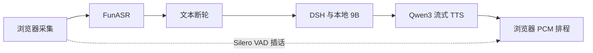

# DSH Voice AI

[English](README.md) · **简体中文**

**在单张消费级 GPU 上，为可调用工具的助手提供可插话的中文语音交互。**

## 想解决的问题与产品场景

桌面助手的键盘输入会打断免手持使用。本项目为 DeepSeek Harness（DSH）增加持续语音采集、语音回复和插话；对话、工具与会话状态仍由 DSH 管理。

目标是自然提问、及时听到回答，并在更正时不丢开头、不重播旧语音。当前先测清失败发生在哪里，再决定修改默认行为。

## 采用的方法



Python bridge 管理语音模型和协议；[独立插件](https://github.com/HenryVarro666/dsh-voice-ai-girlfriend-plugin)管理采集、投递和播放。LLM 独立运行，仍会与 TTS 争用 GPU。已有数字人适配接口，但实际 DUIX 生成尚未验收。

## 当前做到哪里

- RTX 5080 16 GB 已运行中文 ASR → DSH/本地 Qwen3.5 9B → Qwen3-TTS 0.6B。
- 采集/播放修复覆盖首条回复、保留换行切句、有界静默预录、旧结果失效和数字人不可用时回退。
- 当前源码包含模块整理和独立取消候选，与最近测量的部署构建不同。公开仓库不等于部署这些候选。
- 真人麦克风、外放回声、长会话及干净安装仍待验。这是支持插话的级联链路，不是原生全双工模型。

## 得到的结果与采用决定

| 探索 | 已有证据 | 决定 |
|---|---|---|
| [17 轮完整链路](docs/experiments/2026-10-20-player-validation/RESULTS.md) | 新会话首次 3.75 秒；16 热轮 1.04–2.01 秒 | 保留基线；不声称稳定 p95 |
| [固定 ICL 取消生命周期](docs/experiments/2026-10-20-cancel-lifecycle/RESULTS.md) | 首 PCM 前消费者关闭→生成退出中位 1948.4→63.3ms；排队取消 0/2 调用模型 | 有价值的独立修复；不是普通轮提速；未部署 |
| [取消/恢复压力验证](docs/experiments/2026-10-21-cancel-recovery/RESULTS.md) | 36 项 HTTP、8 次程序停播；队列峰值 70/38→8/8 | 积压有界，但发送停滞仍可能无限占锁 |
| [模型大小与尾部保护](docs/experiments/2026-10-20-stream-guard/RESULTS.md) | 1.7B 无总体首声收益、多约 2 GiB；幅度裁剪会删弱声 | 保留 0.6B，裁剪关闭 |
| [生成条件对照](docs/experiments/2026-10-20-generation-layout/RESULTS.md) | 仅说话人向量改善独立 handler 计时，但改变音色条件 | 待音色/韵律/内容审查，继续实验 |
| [中文断轮](docs/experiments/2026-10-19-turn/RESULTS.md) | 合成音与朗读结论不同；语义完整仍可能是句中停顿 | 不预设模型断轮优于真人静音计时 |

完整链路从合成输入最后有声采样计到 AudioContext 首有声排定，不含硬件、真人或 AEC。新会话首次不是严格冷启动。取消和独立 handler 使用不同起止点。

## 实验如何查看

先读[决策索引](docs/EXPERIMENT_INDEX.md)，再看[详细实验](docs/EXPERIMENTS.md)。各实验目录保留计划、汇总数值、脚本和局限；负结果与未采用候选也保留，不把所有数字堆在 README。

## 构建与使用

[安装指南](docs/SETUP.md)说明模型获取和本地配置。以下 CPU 检查无需权重：

```bash
python -m pip install -r requirements-dev.txt
python -m unittest discover -s bridge/tests -v
python scripts/check_docs.py
```

浏览器 bundle 在独立插件仓库构建。`dsh-plugin/` 用于可选 monorepo 接入，其 `src` 与独立插件镜像，但包/构建配置不同。[架构](docs/ARCHITECTURE.md) · [开发说明](CONTRIBUTING.md)。

## 下一步

1. 定义发送停滞期限和整请求持锁预算，同时坚持线程退出后才释放推理锁。
2. 完成共锁兼容及实际候选替换/恢复验收。
3. 验真人麦克风/耳机与外放/AEC，再扩大延迟样本。
4. 用冻结质量与失败对照重新判断断轮及 TTS 条件。[设计与验收路线](docs/DESIGN_ROADMAP.md)。

## 来源与公开范围

基于 [beiyege-01/dsh-voice-ai-girlfriend](https://github.com/beiyege-01/dsh-voice-ai-girlfriend)。本仓库是保留上游署名和许可证的纯源码发布；含原始视频的上游历史不重发。[来源与排除规则](PUBLICATION.md)。

不包含权重、凭据或原始/生成音视频，模型和媒体权利另算。详细指南主要为中文；双语入口共用证据。[工作区地图](https://github.com/HenryVarro666/voice-ai-workspace)。
