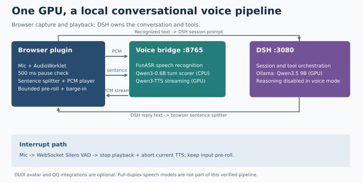

# 语音链路架构与维护约束

## 模块边界

| 模块 | 职责 | 不应承担的职责 |
|---|---|---|
| `voice_bridge.py` | HTTP/WS 路由、模型生命周期、推理互斥、TTS、可选 DUIX/QQ | 主对话 LLM 与 DSH 会话管理 |
| `turn_detection.py` | 可独立构造的文本与音频断轮判定器；按需加载权重 | 读取全局 bridge 配置或创建 HTTP 服务 |
| `audio_codec.py` | PCM/WAV 解码、重采样和编码 | 模型、网络或会话状态 |
| 插件 `bridge.ts` | 网络协议及旧服务回退 | 录音状态机 |
| `recorder.ts` | 缓冲、静音计时、异步判定作废、插话输入 | DSH 提交与音频播放 |
| `reply-listener.tsx` | DSH 回复订阅、历史保护、切句与串行合成 | PCM 字节解释 |
| `speaker.ts` | PCM/WAV 队列、浏览器时钟调度、取消播放 | 识别或模型推理 |

独立插件仓库是前端源码的编辑来源，主仓库 `dsh-plugin/src` 是镜像。用 `scripts/sync_plugin.py --check` 比较，用 `--apply` 显式复制；工具不会自动删除额外文件。Python 主文件仍保留上游可选集成，后续可按测试覆盖逐步拆分，避免一次大规模重写。

## 音频接口

| 接口 | 请求 | 响应 |
|---|---|---|
| `GET /api/health` | 无 | 模型 readiness 与加载错误；未加载不代表 HTTP 服务不可用 |
| `POST /api/stt` | raw PCM16 LE mono 16 kHz，或 WAV | `{text, language}` |
| `POST /api/turn` | 截至停顿的音频，格式同上 | `{complete, probability, ms}`；文本模式加 `text, stt_ms` |
| `POST /api/tts` | JSON `{text}` | 完整 WAV，16 kHz mono PCM16 |
| `POST /api/tts/stream` | JSON `{text}` | raw PCM16 **little-endian**，16 kHz mono；头 `audio/pcm;rate=16000;channels=1;format=s16le` |
| `WS /api/vad` | 连续 PCM16 LE 帧 | `speech_start` / `speech_end` |

旧部署曾把 little-endian PCM 标成 `audio/L16`，而 L16 通常意味着网络字节序。整理版修正标签，字节格式不变；前端继续按 little-endian 解码。客户端必须跨网络分块保留不足两个字节的尾部，不能假设每块都是偶数字节。

## 断轮状态机

- 开口前保留约 500 ms PCM；块边界可能使其略高于 500 ms。
- 静音 500 ms 后询问 `/api/turn`。文本模式返回的识别结果可直接提交 DSH。
- `complete=false` 或请求仍在等待时，MicButton 配置 1200 ms 兜底；若服务不可用，改用 1800 ms。
- 用户继续说话时递增 generation，旧请求即使稍后返回 complete，也不能提交旧音频。
- 播放期间输入保留最近 1 秒，收到 Silero 插话事件后从这段缓冲开始新一轮。

断轮不是可靠的中文“句意完整”判定。当前文本分数是开放 user turn 后结束符和句末标点的概率和，不是经过校准的置信度。文本阈值 0.2 是实验选择，参见 [实验](EXPERIMENTS.md)。

## 并发与取消

ASR 与 TTS 在 bridge 中共享 `infer_lock`。文本断轮的 STT 部分也进入该锁，CPU 小模型评分在锁外；文本模型自身的锁覆盖加载与评分，避免重复加载。Smart Turn 使用独立 ONNX CPU session。

流式 TTS 的生产任务在后台线程中生成音频，事件循环通过队列发送。独立 task 持有 `infer_lock` 直到生产线程退出；响应取消不能提前释放 GPU 锁。前端 `stop()` 停止已排定的 sources、取消 stream reader，并使旧 generation 失效。OmniVoice 是整句原子调用，取消只能在调用返回后处理。

部署版仍有两处取消边界：排队断开的请求拿锁后仍开算，生成前导静音时要等handler首PCM才检查事件。[独立取消候选](experiments/2026-10-20-cancel-lifecycle/RESULTS.md)用`StreamJob`区分排队与运行：只取消排队等待，运行中保留持锁task，原始模型块前后检查事件并在退出时关闭生成器。它没有改生成参数、handler前导处理或尾部裁剪；只在实验入口运行，尚未部署。HTTP框架须把断连传到body的finally，且单个CUDA操作不能被事件中途打断。

[v2恢复验证](experiments/2026-10-21-cancel-recovery/RESULTS.md)进一步用8元素有界队列、线程任务shield与重复取消等待、错误传递及JobResponse显式断连/aclose清理处理生命周期。ASGI2.3/2.4在CPU回归；实际HTTP、浏览器与独立重启另测。生产仍没有导入该模块。有界队列会在持锁线程内等待，受控慢发送把两条音频持锁拉长到3.32/1.70秒；没有发送停滞期限时仍可能无限占锁，部署前须补期限与整请求预算。不得提前放锁或丢PCM来伪造清理完成。

LLM 位于 ollama 进程，bridge 的锁不会约束它；LLM 与 TTS 仍会竞争 GPU。当前流式队列没有独立的多用户调度或按用户隔离，服务定位为单用户本地部署。

## 回复与历史保护

`reply-listener` 在第一个非空快照冻结历史基线。不能只依赖 running/settled：新会话首条回复可能直接以 settled 出现。切句必须对流式前缀稳定，否则按句子序号记录的已读进度会漏读或重读。

Markdown 清洗保留列表末尾换行；首段允许在中文逗号处较早切开，每段最多 60 字。不要在完整回复结束后重新对前文做不同的切分。

数字人开关挂载时读取 bridge，而不是把浏览器默认值写回。只有 bridge 开启且 DUIX running 才走视频；否则继续普通朗读。每个 DSH 标签页都会挂载自己的监听器，两个页面同时打开可能导致重复朗读。
