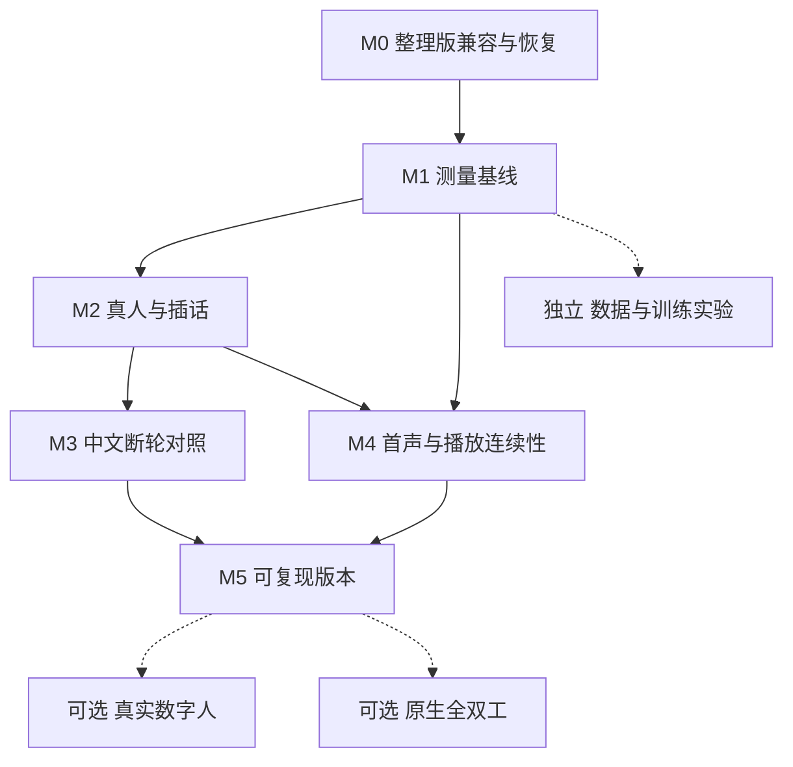

# DSH Voice AI 设计与改进路线

2026-10-24独立Avatar E5a：[真实TTS→实际ReplySpeaker→视觉时钟](https://github.com/HenryVarro666/speech-avatar/blob/main/experiments/2026-10-24-e5-live-tts/RESULTS.md)验证7请求/5完整、客户端更正取消和传输断流恢复。CPU实时门槛未过；这是隔离测试，没有替换DSH默认服务，不替代M2真人麦克风/回声或ASR/翻译整链路验收。

更新日期：2026-10-20。适用范围是单用户、单张消费级 GPU 上的 DSH 中文语音助手。接下来的主线是：验证整理版与旧部署行为一致，建立可比较的测量，再根据真人失败样本改善断轮和首声延迟。数字人与原生全双工作为独立实验推进。

本文是下一阶段的设计建议和执行依据。下文标为目标的数字尚未达成，阶段任务按实际证据更新。已完成的工作和历史结果以[实验记录](EXPERIMENTS.md)为依据，现有协议见[架构说明](ARCHITECTURE.md)。

2026-10-20 已完成独立的[使用价值判断与 TTS 争用诊断](experiments/2026-10-20-tts-contention/RESULTS.md)，正式 60 次。它直接调用旧部署 bridge，不改变服务或配置，因此可在不部署维护候选的情况下开展；不替代 M0 兼容回归或 M1 完整链路计时。后续优先真人可靠性与首句策略，小幅收益尚不支持重写生产调度。

同日后续完成[首句策略36轮对照](experiments/2026-10-20-first-clause/RESULTS.md)和[隔离40seed长尾追踪](experiments/2026-10-20-tts-tail/RESULTS.md)，保留当前切句，复现生成前导静音等待。新发现约5秒段尾低幅度音频，离线裁剪在四段上移除约5秒且ASR匹配。下一项性能原型优先验证流式尾部保护，并加入软声尾音、句中停顿、缓冲上限和取消负例；它尚未实现或部署。

随后完成[流式段尾保护与 104 条模型对照](experiments/2026-10-20-stream-guard/RESULTS.md)：已实现未启用的有界原型，v2 先放行 300 ms 余量，在旧包时序及新生成重放中未新增估算欠载或推迟首声。轻声尾词误裁反例仍存在，下一步是回听及实际浏览器候选链路，不能默认部署。模型保留 0.6B；新文本每模型 40 条，1.7B 没有整体首声收益且多约 2 GiB 显存。此结果不代替 M0 部署回归、真人输入或双工方案验证。

2026-10-20 后续[生成端小实验](experiments/2026-10-20-generation-end/RESULTS.md)用重复惩罚1.15改善已知静音长尾，未增加尾部裁剪；24条新文本对照没有一般提速，听感与取消未重新验收。下一步先冻结新文本与天然轻声、重复词负例并回听，不部署采样参数或EOS硬阈值。此独立诊断不替代M0/M2/M4验收。

## 阅读导航

生成端随后完成[正式80条布局/参考条件/出块对照](experiments/2026-10-20-generation-layout/RESULTS.md)，受干扰首轮另存。chunk2声学码与基线20/20全同，未解决静音且整句更慢；逐步文本保留长静音反例。仅向量新文本首有声143.0→92.2ms，但改变克隆条件，尚未回听或测完整DSH。M4优先验音色/韵律与同参考片段消融，不继续按幅度删尾。相同PCM的ASR重复存在0/0/2编辑，内容验收须补重复测量或人工确认。独立诊断仍不替代M0、M2及M4完整验收。

随后已制作[32对向量/ICL盲听页](experiments/2026-10-20-xvector-listening/RESULTS.md)，包括12对新增自然结尾；参考、原始WAV、随机A/B、评分保存与导出已准备并验证。用户已告知完成试听并导出，评分原件未接入，音色、韵律与末字未验收；评分不阻塞独立自动内容与性能实验，也不允许直接进入默认参数部署。后续仍需实验开关、参数契约、取消及完整DSH复测。

2026-10-20后续[取消生命周期候选](experiments/2026-10-20-cancel-lifecycle/RESULTS.md)已修复独立入口的排队开算与首PCM前检查边界：12取消无晚source，固定ICL时首块前退出1948.4→63.3ms、排队取消0/2调用模型。8队列与4固定首句对照PCM全同。18DSH中快速1.196/1.173秒、兜底1.886/1.749秒（旧/新，各4热轮），混合中位1.493/1.495秒；首句均不同，不宣称一般首声收益。随后完成下述恢复压力验证；仍待发送期限、共锁兼容及生产替换恢复验收；生产与裁剪未改，M2真人及M4总体仍未验收。

2026-10-21完成[v2恢复压力验证](experiments/2026-10-21-cancel-recovery/RESULTS.md)，2026-10-22归档：36HTTP、4组/8次播放器停止与独立重启通过，81服务端/47客户端WAV和88本地/13apex生命周期测试通过。有界队列峰值70/38→8/8，但慢发送持锁0.83/0.48→3.32/1.70秒，仍可能在发送停滞时无限占锁。下一项先定义并验证发送停滞期限与整请求持锁预算，停止后等线程退出再放锁；再完成M0共锁兼容和实际替换恢复。独立进程重启不等于生产回滚，程序stop不等于真人插话，M0整体/M2均未验收。生产与裁剪保持原样，本轮没有新完整DSH首声数字。

- [起点与约束](#起点与约束)
- [阶段依赖与验收总表](#阶段依赖与验收总表)
- [M0 整理版回归与可恢复部署](#m0-整理版回归与可恢复部署)
- [M1 统一测量与基线](#m1-统一测量与基线)
- [M2 真人输入与插话可靠性](#m2-真人输入与插话可靠性)
- [M3 中文说完判定](#m3-中文说完判定)
- [M4 首声延迟与播放连续性](#m4-首声延迟与播放连续性)
- [M5 维护性与可复现发布](#m5-维护性与可复现发布)
- [可选实验](#可选实验)
- [第一批任务与记录模板](#第一批任务与记录模板)

## 起点与约束

### 已有能力与未解决问题

| 方面 | 当前证据 | 对后续设计的影响 |
|---|---|---|
| 基础语音 | FunASR、DSH/本地 9B 与 Qwen3 流式 TTS 跑通 | 保留现有链路作基线，每轮只改变一个主要因素 |
| 延迟 | 真实 DSH 中四轮合成输入为 2.793 / 1.167 / 1.850 / 1.056 s | 样本不足以给稳定 p95；首轮未控制模型缓存，不能称严格冷启动 |
| 文本断轮 | 500 ms 开始判断，阈值 0.2，未完 1200 ms 兜底 | 完整短句常走兜底；快速策略可能增加句中截断 |
| 断轮对照 | FLEURS 模拟：现策略平均等待 0.89 s、源句截断 9.5%；固定 1.0 s 为 6.6%，固定 1.2 s 为 3.4% | 现策略并未在真人对话中证明优于固定等待，不继续盲目降低阈值 |
| 音频 Smart Turn | 中文合成音与真人朗读结果差异大 | 不直接恢复为默认；需要新的中文证据才能重新考虑 |
| 插话与预录 | 合成输入验证了开头缓冲和长期静默有界 | 真人麦克风、外放回声、软声和长句仍需测试 |
| 维护候选 | 本地前后端各 11 项测试通过，判定与音频模块已拆出 | 局部类型/CPU 检查不能替代整理后的 GPU/DSH 回归 |
| 资源 | 已在 RTX 5080 16 GB 上运行；历史整卡加载约 12.6 GB | 每次实验重新记录显存，不能按历史余量安排新模型 |

上述统计的样本、分母与输入条件见[实验正文](EXPERIMENTS.md)和[断轮归档表](experiments/2026-10-19-turn/RESULTS.md)。FLEURS 是真人朗读，td3k 是合成文本；二者都不能代替真人交互测试。

### 两个代码状态

按最近一次部署记录，运行的是整理前已测版本；本地存在模块整理后的候选，二者尚未合并为一个新部署。本轮只编写文档，没有重新核验在线状态。

| 状态 | 插件 SHA-256 | 已有验证 |
|---|---|---|
| 最近测量/部署版 | `4519465705834132671dced9ddd784d9ad519355754ac02e985cb5dbc2e28f74` | 已归档的四轮 DSH 端到端与预录实验 |
| 本地维护候选 | `19fea69ff6dfbea220a4941fc5ceef0286970647b728b9d51bee08546e3af1bb` | 前端核心、后端 CPU/HTTP 契约、跨目录构建；未部署验证 GPU 全链路 |

这些哈希定位本次文档起点，不能替代未来的部署清单。Python 后端还要记录主模块与抽出模块的内容哈希；仅记录插件哈希不足以恢复整个实验。

### 保持的边界

DSH 管理主对话、工具和会话；bridge 管理语音模型及协议；插件管理采集、投递与播放。先保留这种分工。单用户稳定性没有证据前，不加入多用户调度或集群。

实验使用独立目录和配置。不要为本项目停止主机上的其他服务或训练任务；需要比较冷启动时只处理本项目明确识别出的进程和模型。外部 GPU 负载不可控时记录为受干扰样本，保留数据，另行重跑。

默认参考音频、真人录音和带 token 日志留在本地。公开仓库保存有权分发的样例、去标识的统计及必要复现代码。提交、推送和生产部署分别记录；本文没有执行这些操作。

## 阶段依赖与验收总表



M3、M4 在基线稳定后可以分别准备，但同一张 GPU 上的测量串行进行。依赖管理与文档可以贯穿各阶段；M5 是完成安装与发布验证的节点。

| 阶段 | 要回答的问题 | 交付物 | 进入下一阶段的条件 |
|---|---|---|---|
| M0 | 整理是否改变已测行为，能否恢复？ | 候选/旧版清单、回归结果、恢复步骤 | 关键功能通过；旧版可恢复；无新增无声或重播问题 |
| M1 | 延迟和失败具体发生在哪里？ | 统一事件定义、逐次记录、固定输入与分组基线 | 计时可解释，失败不从分母消失，不混合冷/热与合成/真人 |
| M2 | 真人说话和播放中插话是否可靠？ | 耳机/外放用例、错误分类、标注样本 | 耳机主链路无已知阻断问题；外放未过则明确只支持耳机 |
| M3 | 判完模型是否比固定等待更有用？ | 同集对照、阈值选择、保留或关闭的决定 | 在冻结测试集达到等待/误截断的联合标准 |
| M4 | 如何减少首声长尾和句间空档？ | 阶段耗时、受控消融、播放质量对照 | 端到端收益成立，发音、插话和资源占用不劣化 |
| M5 | 他人能安装并恢复相同版本吗？ | 验证过的安装、依赖记录、双仓库对应版本与发布资料 | 干净目录安装成功，真实 CI 通过，文档和构建一致 |

### 首版目标的使用方法

以下为建议的工程目标，M1 基线建立后可以调整，但要先写明调整理由。不能通过删掉慢样本或只统计“判完成功”的轮次达标。

| 项目 | 候选目标 | 测量边界 |
|---|---|---|
| 热运行首声 | p50 ≤ 1.5 s，p95 ≤ 2.5 s | 首次评估每种配置至少 100 轮；单用户、耳机，记录网络；新会话与冷启动另报 |
| 关键回归 | 冻结回归集零漏读、零历史重播、零旧结果提交 | 只表示该回归集通过，不外推所有输入 |
| 断轮改进 | 相对固定 1.2 s 基线，平均端点等待至少减少 100 ms，源句误截断率不增加 | 同一冻结集、相同 ASR，比较不确定区间；证据不足继续留作实验 |
| 插话 | 相对 M2 的旧版，停播时延和开头丢字均不劣化 | 耳机与外放分开；同时测无真人输入时的误打断 |
| 稳定性 | 至少 60 分钟、100 轮的本地会话，无持续队列/显存增长或挂起任务 | 只声称该时长通过，继续公开偶发失败 |

100 轮的 p95 仍会有明显采样波动。报告样本数、最大值和分位数方法，条件允许时给重采样区间；小样本先列逐次结果，不包装成总体性能承诺。首轮和冷启动暂不设绝对速度目标，先测加载与提示处理开销。

## M0 整理版回归与可恢复部署

### 执行顺序

1. 冻结旧部署清单：插件 bundle、bridge 及其导入模块、运行依赖、模型名称/修订、有效配置和参考音色标识。配置备份存本地，不进入公开结果包。
2. 为候选建独立工作目录，用明确配置路径启动检查。不同端口不代表模型隔离，GPU 测试仍需资源窗口，避免同时加载第二套完整语音模型造成 OOM。
3. 执行 CPU/前端检查，再进行真实 DSH 兼容测试。新 Content-Type 是 `audio/pcm;rate=16000;channels=1;format=s16le`，验证字节仍为 little-endian，旧 WAV 回退可用。
4. 验证候选的替换和恢复路径。替换前备份实际 profile 包文件，遵守 pnpm 硬链接规则；候选 bridge 必须连同新模块一起部署，不能只覆盖入口文件。
5. 部署后从页面实际请求的 bundle 核对哈希，硬刷新并关闭重复标签页。只看到本地构建成功不算部署完成。

### 关键回归集

| 用例 | 通过条件 |
|---|---|
| 新会话首条回复 | 有文字、有首声，只读一次 |
| 刷新已有会话 | 历史不被重新朗读 |
| 数字人关闭或不可用 | 普通 TTS 正常；页面挂载不自动启动数字人 |
| 列表、Markdown、流式半截代码 | 不读代码；换行边界稳定；没有漏句与重句 |
| 完整短问句、未完短语、停顿后续说 | 每轮只投递一次，续说使旧判定失效 |
| 静默 35 s 后开口 | 上传音频保持有界，不出现超长 422 丢句 |
| 播放时插话 | 排定音频停止，旧请求不再续播，保留开头输入 |
| `/api/turn` / 流式 TTS 不可用 | 有确定的静音计时 / WAV 回退；不无限等待 |
| 切换会话、关闭麦克风、网络中断 | 无旧会话内容串入，无悬挂播放或无限重试 |

自动测试与 UI 测试各自记录。用人工构造的列表喂给真实监听器，避免再次依赖 LLM 恰好按指令生成列表。重复或漏读一旦出现，保留触发输入；修复后纳入回归集。

当前取消候选的额外阻断项：发送不再前进但未断连时必须有明确失败期限；等待线程退出后放锁，后继请求可恢复，普通客户端PCM不变。记录受控慢发送与真实网络分别覆盖了什么。2026-10-21独立恢复测试尚不满足生产替换/回滚验收。

**退出条件：** 新旧版本的关键行为一致；候选没有新增的阻断错误；恢复路径有一次实际验证记录。CPU 通过不能单独满足 M0。

## M1 统一测量与基线

### 事件与时间定义

| 事件 | 定义 | 时钟与来源 |
|---|---|---|
| `speech_end` | 用户本轮最后一个有声输入采样 | 合成输入用已知采样；真人录音经人工检查的对齐点 |
| `turn_check_start` / `turn_check_end` | 断轮请求发起 / 返回 | 浏览器单调时钟；服务端另记 ASR 与评分耗时 |
| `transcript_ready` | 可提交的最终文字可用 | 浏览器；区分复用 turn 识别和兜底重识别 |
| `prompt_submit` | 向真实 DSH 会话提交 | 浏览器；不是 HTTP STT 完成的别名 |
| `reply_first_token` / `reply_first_clause` | 首个可见文本 / 首段可朗读文本 | 浏览器订阅事件；无可靠首 token 观测时保留 null |
| `tts_request` / `tts_first_byte` | 发起首句合成 / 收到首字节 | 浏览器；服务端另记排队、模型首块 |
| `first_voiced_output` | 第一个有声输出采样的预定播放时刻 | AudioContext 时钟与采样偏移，定义有声阈值 |
| `barge_onset` / `playback_stopped` | 插话开始 / 排定播放停止 | 同一浏览器时间线；另记服务端生成任务退出 |

首字节可能仍是静音。模型 first chunk、客户端 first byte 和 first voiced output 分别记录。总延迟定义为 `first_voiced_output - speech_end`；语音回复最终没发声也要保留为失败，不能从延迟数据中静默删除。

浏览器 `performance.now()`、AudioContext 时间和服务器单调时钟不直接相减。浏览器事件映射到同一局部时间线；服务器返回本地阶段时长，通过请求 ID 关联。跨机排队/网络只能在明确同步或差分假设下估计，不能把时间差全部归给模型。

真人“听到第一声”的硬件时延若需测量，另建外部录音或回环测量，记录设备和时钟对齐。未测硬件时继续使用“浏览器预定首声”表述。

### 记录结构与接口设计

建议新增可关闭的诊断记录，沿用当前 HTTP 端点，不为了计时重写协议。请求携带非敏感 `request_id` 与本轮 `utterance_id`；服务端日志写入关联 ID 和阶段耗时，浏览器保存事件。当前尚无完整贯通记录，字段需在实现时以兼容方式增加。

每次实验保存 `manifest.json`、`trials.jsonl`、`summary.md`；有权保存的输入音频另放本地目录。公开版只导出去标识结果。最小字段如下：

```json
{
  "trial_id": "warm-headset-001",
  "build": {"plugin_sha256": "<hash>", "bridge_manifest": "<hash>"},
  "condition": {
    "input": "real_microphone",
    "output": "headphones",
    "cache": "warm",
    "turn_policy": "text-0.2-fallback-1.2",
    "llm_context_tokens": null,
    "other_gpu_load": null
  },
  "latency_ms": {"endpoint_asr": null, "dsh_first_clause": null, "tts_play": null, "total": null},
  "outcome": {"premature_end": null, "prefix_lost": null, "false_barge_in": null, "error": null}
}
```

这是建议结构，不是已实现接口。未知值写 null，失败写错误类型；原始事件与派生汇总分开保存。模型、参考音频哈希、浏览器版本、采样率及网络环境放在 manifest 中，不在每一行重复。参考音频身份不以个人姓名命名。

### 基线与样本安排

先做每种配置 20–30 轮的小样本找问题，再扩大。正式热运行比较每种配置至少 100 轮，使用同一固定输入集并交错配置顺序，避免模型预热或时间漂移偏向某方案。分别保存：

- **固定等待基线：** 1.8 s 和 1.2 s；ASR、LLM、音色及切句保持相同。比较 1.0 s 时单列，不能拿更激进的等待冒充旧版。
- **当前文本策略：** 500 ms 检查、阈值 0.2、1200 ms 兜底。
- **候选策略：** 一次只替换断轮、切句、TTS 参数或调度中的一项。

“新会话首轮但模型仍在内存”和“本项目模型明确卸载后首轮”是不同组。严格冷启动要写清哪些模型卸载、哪些磁盘缓存仍保留；不能为制造冷启动停止其他业务。长会话另记录提示 token 数，因为聊天上下文增长会改变 LLM 首段时间。

**退出条件：** 每条记录能解释总时延来源；三类启动状态分别可读；成功数、错误数和总尝试数一致；临时假麦克风/计时脚本没有进入发布 bundle。

## M2 真人输入与插话可靠性

### 输入矩阵

首轮由本地实际使用者完成耳机和外放两组，每组至少 30 条，优先暴露问题。后续加入更多说话者和设备；只测一个人时不声称覆盖不同口音。

| 类别 | 示例或方法 | 重点记录 |
|---|---|---|
| 完整短句 | “你好”“我回来了”“讲个笑话吧” | 是否误判未完、是否无声、等待多久 |
| 未完与犹豫 | “我想问一下那个……”后继续 | 是否提前提交，原句意图是否被拆成两轮 |
| 内部停顿 | 设计 0.3 / 0.5 / 0.8 / 1.2 / 1.8 s 停顿，再自然表达 | 人工停顿与自然停顿分组，不混作真人自然统计 |
| 发音与词汇 | 轻声、较快语速、人名、数字和中英混合 | ASR 错字与断轮误判分别计数 |
| 播放中插话 | 回复刚开始、句中、两句交界处开口 | 停播时间、开头字、旧音频是否恢复 |
| 无意图声音 | 仅播放助手、人为咳嗽、键盘声 | 是否误唤起或误打断 |
| 长静默与长输入 | 闲置后说话、接近录音长度上限的输入 | 缓冲、截断提示、超限是否可恢复 |

每条由听原录音的人标记“这里真想结束”或“这里仍想继续”，不要只凭转写末尾标点生成标签。额外标注 ASR 是否保留影响意图的词，以及插话开头是否丢失；“文字有错”和“意图丢失”分别统计。

### 插话与回声的设计顺序

先确认浏览器实际采用的 echoCancellation、noiseSuppression 等轨道设置及设备输入/输出，不把请求的约束当作已启用效果。耳机组用于隔离外放回声；外放组固定音量和设备距离，再改变一个因素。

若外放频繁触发 Silero，先分析回声与用户语音的时间线。候选依次是设备/AEC 设置、VAD 连续帧规则和播放参考相关性；后两者会影响软声用户，必须同时测漏打断。不能通过播放时禁用全部麦克风来“修好”可打断功能。

插话触发后区分三个终点：客户端停止已排定播放、取消当前响应、后台生成线程退出。最后一个决定 GPU 锁何时释放。断开网络后的旧线程仍在跑时，不允许提前让下一条 GPU 推理并发进入。

**退出条件：** 耳机组关键意图和插话开头可用，已知阻断失败被修复并复测；外放组如未达标，README 和默认使用说明限定耳机，继续保留外放失败证据。

## M3 中文说完判定

### 先定义优化对象

当前“开放 user turn 后结束符和句末标点的概率和”是启发式分数。它能识别部分未完短语，但一句在语法上能结束，不代表真人此刻想交出话轮。判定依据需要结合停顿、增量转写和真人意图标签。

主要指标是源句误截断率和完整轮次的等待时间。分类 AUC 作为辅助；不以高 AUC 代替真实对话成功。FPR 按停顿切点计算时，与按源句计算的截断率分开报告。

### 候选设计与尝试顺序

| 方案 | 改动 | 优点与代价 | 启动条件 |
|---|---|---|---|
| 固定计时 | 保留 1.2 / 1.8 s | 简单可恢复，是所有复杂策略的对照 | M1 即可 |
| 现有文本评分 | 调整阈值和兜底的实验参数 | 改动小；无法消除语义已完但用户还要继续的问题 | 有开发集与冻结测试集 |
| 增量文本加停顿 | 判断转写是否稳定，组合停顿长度与分数 | 可能减少 ASR 修订误放；额外 STT 检查增加争用 | 测过 STT 排队成本后 |
| 更适配中文的模型 | 训练或替换判定器 | 需要意图标签和跨说话者评测 | 轻量方案已有明确失败类型 |
| 音频与文本融合 | 同时利用韵律和语义 | 系统更复杂；现 Smart Turn 真人中文证据不足 | 独立证明音频特征有增益后 |

标点模型不能用最终补上的“。”当作说完标签；若评测它，应读取最后位置的句末类别分数。现有标点模型归档仍可作对照，不重复把强制补标点的输出当判定能力。

### 建议实验协议

1. 冻结 M2 失败集，按源录音和说话者分开发集/测试集；同一句的完整与截断片段不跨集合。
2. 第一轮仅扫描阈值 `0.1 / 0.2 / 0.35 / 0.5` 与兜底 `1.2 / 1.5 / 1.8 s`，500 ms 检查保持不变。只在开发集选择，不看测试集调参。
3. 用同一份原始音频和固定 ASR 比较判定能力；再用完整在线链路测 ASR 与排队的共同影响。离线模拟与在线结果分别报告。
4. 若需要重复 STT，先限制每轮检查次数并记录 GPU 锁等待。新增有声输入使旧请求结果失效；异步完成晚于提交或 stop 时必须丢弃。时间戳/音频版本不一致时不复用旧转写。
5. 达不到“误截断不增加且等待减少”的联合目标，就保留固定等待作为推荐基线；复杂策略继续留在实验配置。apex 默认是否切换由后续实际部署任务确定。

**退出条件：** 冻结测试的联合指标有改善，关键短句没有新增阻断问题，给出可恢复的配置；否则输出“不采用”的实验结论，同样算完成本阶段。

## M4 首声延迟与播放连续性

2026-10-20 已完成[实际播放器与17轮真实DSH验证](experiments/2026-10-20-player-validation/RESULTS.md)。正式31项播放器含弱尾、真正句中停顿、迟到、连续两段和取消；基于原生产版本，未替代M0。阈值3在6条受控弱尾上保留已知语音，异常两段播放缩短约4.9秒；旧阈值99六条均误裁。两条等待路径分别比较，未证明首声改善。继续不部署；下一项以人工回听、天然弱声及生成终止证据为主，保留严格数字零候选的独立否定结果。

2026-10-20已按无评分路线完成[数字复核和48条默认/向量对照](experiments/2026-10-20-numeric-recheck/RESULTS.md)。原110022疑点20次稳定10022；默认字节复现旧5.413秒尾部，向量同seed降到0.121秒。既有64音频三次识别均匹配；新编号默认18/18、向量17/18三次字段稳定，诊断各5/6。新编号首有声PCM中位184.4/91.9ms，仅为独立handler。下一项优先处理三条具体ASR疑点，再在独立入口补取消、队列和完整DSH；不以自动匹配宣布音色/天然轻声通过，不要求重填32对，不改生产、不采用1.15、不裁剪。

随后完成[定向识别与独立集成验证](experiments/2026-10-20-xvector-integration/RESULTS.md)：12取消无晚播放，但已取消排队请求仍开算；8队列长尾组12.109→4.545秒。18DSH中16热轮快速1.150/1.038秒、兜底1.787/1.672秒，各4条；全部配对首段不同，且双份TTS及共同缓存清理与生产不同，不能称M4总体验收。向量110022/6619两识别器少位标记仍在。下一项优先在独立入口修取消时不再开算、验证首PCM前取消边界，再预写新输入/回复条件完整链路；M0部署回归与M2真人仍待完成，不采用向量或裁剪。

### 优化顺序

先用 M1 事件区分慢在断轮、DSH 生成第一段、bridge 排队、模型首块还是首块静音。每次只动一个因素，不先把全部参数调小。

| 位置 | 优先实验 | 主要风险 | 需要的对照 |
|---|---|---|---|
| DSH 首段 | 比较短/长人设与工具提示，新会话/长历史，保留工具能力 | 短提示可能改变回答和工具行为 | 相同任务的回复正确性、首段时间和 token 数 |
| 切句 | 首段最短长度、逗号切分、最大块长度 | 更短片段伤语调，或流式前缀不稳定导致重读 | 同一回复文本，首声、句间间隔和可听质量 |
| TTS 排队 | 单独 TTS 与 LLM 同时生成时对比，记录锁等待和外部 GPU 负载 | 误把 LLM 竞争归因于 TTS 参数 | 同文本、同音色、相同加载状态 |
| TTS 生成 | 小范围比较 chunk size 与预热策略；有数据再试采样参数 | 低延迟可能换来不稳定发音或音色 | 首有声块、整句耗时、错字和重复 |
| 首块静音 | 区分生成静音的耗时与客户端排队静音 | 直接剪掉低幅度音频可能丢轻辅音 | 原始音频人工听检，不能只看振幅阈值 |
| 播放器 | 测真实网络抖动、buffer underrun 和取消 | 过多预缓冲延迟首声，太少出现断续 | 有声首播、欠载次数和句间空档 |

TTS 自身指标用冻结文本脱离 LLM 比较；最终方案必须回到真实 DSH 复测，不能把独立 TTS 的最快首块当成端到端提升。只提前生成一段提示音不计入答案首声。

### 调度与流量控制

保持单张 GPU 上 ASR/TTS 的明确互斥，先观测 CPU 断轮与 GPU 队列。LLM 位于另一个进程，bridge 的锁不能让它让出 GPU。需要干预 LLM 调度时单独立项，以免同时改 host 和语音模块后无法归因。

当前音频队列还没有完整的背压设计。慢客户端、页面后台或连接断开可能让已生成块积压。若实测出现增长，下一步增加队列上限与生产取消机制；线程向 asyncio 队列送数据时遵守线程安全，不能直接阻塞事件循环，也不能简单丢 PCM 块导致音频缺字。

**退出条件：** 至少在固定文本和真实 DSH 两层验证收益；首声分布、播放质量和插话行为同时达标。若只能改善后续句连续性，就按这个收益发布，不声称第一声更快。

## M5 维护性与可复现发布

### 代码边界的下一步

已有 `turn_detection.py` 和 `audio_codec.py`。后续按功能逐步拆，不做一次性目录重构。

| 顺序 | 维护任务 | 完成标准 |
|---|---|---|
| 1 | 明确配置默认值、路径解析和校验 | 无效模型路径/模式有可读错误；示例和真实行为一致；不把凭据写日志 |
| 2 | 将启动/关闭迁到 FastAPI lifespan | 预热、后台任务、流式生产与关闭行为有契约测试；不是只消掉 warning |
| 3 | 独立 TTS 流任务的生命周期 | 取消后生产者最终退出，锁保持至退出；失败可定位，无悬挂队列 |
| 4 | 分离可选 DUIX/QQ 接口 | 语音核心测试无需启动可选服务；原路径和协议兼容 |
| 5 | 扩大 host 类型验证 | 在匹配版本 DSH 中检查 React slots；核心 tsc 通过与完整 host 通过分开记录 |

新增抽象只为已出现的边界服务。不同 TTS 后端能力不一致，取消、流式输出与整句合成必须明确，不为了统一接口伪装成都可实时取消。每次拆分前后运行同一契约集，GPU 行为改变时补真实回归。

### 安装、版本和恢复

- 在干净目录按 [SETUP](SETUP.md) 完成一次安装，记录 Python/Node、驱动、CUDA、torch 与模型修订。当前版本表只是运行快照，干净安装是待完成工作。
- 在验证组合后保存约束文件；按 GPU/系统区分依赖组合，避免把某张卡的 torch 轮子写成通用要求。CPU CI 不安装 CUDA 权重。
- 独立插件是 src 编辑来源，主仓库保留镜像。发布时记录两个仓库的提交及 bundle hash，不用未经发布的上游版本号代表补丁已存在。
- profile 更新仍先备份，再替换实际加载文件；依赖重装后核对补丁是否被覆盖。恢复同时考虑 bridge 新模块与有效配置，不只恢复一个 JS 文件。
- GitHub 发布说明列明输入类型、设备与未验证功能。真实 CI 结果可追溯后再加状态徽章；没有发布的 fork 不编造安装地址。

### 双语文档维护

`README.md` 为英文默认入口，`README.zh-CN.md` 为中文，两者在顶部互链；工作区、主仓库、独立插件和镜像说明均采用这一约定。图片共享同一 assets，测量数字来自同一归档。当前详细安装、架构及路线正文为中文，英文入口明确说明语言。

修改功能、默认值、实验数字或安装命令时，在同一轮同步两种 README。新增文档链接、路径与图片运行检查；自动检查数值/链接只能发现漂移，不能证明翻译等义，仍要逐段对读。未来英文使用者增多时优先补英文 SETUP，再翻译架构和路线，不复制两套独立实验数据。

**退出条件：** 新环境按文档跑通，两个仓库版本对应，CPU/前端与实际远程 CI 通过，完整链路有当前构建的结果；许可证来源和媒体分发范围清楚。是否提交、推送或发布按实际用户任务执行，不在本路线编写中自动执行。

## 可选实验

### 真实数字人

只有语音基线稳定、确认安装条件与实际显存预算后再开始。历史估计 DUIX 需 4–6 GB，不能把它当作当前可用余量或实际测量。先记录 LLM/ASR/TTS 共存峰值，再决定独立 GPU、按需卸载或其他部署方式。

分开验证真实视频首段生成、音画同步、句间空档、刷新重播和插话后旧视频残留。现有 DUIX 替身只证明接口与队列链路。数字人不可用时仍应保留普通语音路径；真实资源或生成速度不合适就保留为可选功能。

### 原生全双工

先定义任务：用户在回答中插话、模型持续听说、取消/修正语音和 DSH 工具调用如何衔接。现有 VAD 打断管线和原生全双工模型分别命名。

候选模型在启动实验时重新核验中文能力、许可和硬件需求，不在本文提前指定“最新最好”。用相同真人用例、相同声学设备和相同工具任务与现有管线比较，测首声、误打断、长会话、显存与工具成功率。若模型只提供语音生成而不支持当前工具工作流，应单列其能力范围。

### 数据与训练

可复用 M1/M2 的事件定义与错误类型，另建数据实验目录，研究音频检查、去重、人工复核及固定预算 ASR 训练。训练/开发/测试按源录音与说话者隔离，合成扩增与真人测试区分，不用同一克隆音色代表真实多说话者表现。

这条路线的交付物是冻结数据版本、训练配置与对照结果；它不依赖真实数字人，也不能用合成演示替代训练收益。具体岗位作品方向保留在本地工作区选题文档，不将私人求职材料带入公开项目 README。

## 第一批任务与记录模板

### 可直接领取的任务

下面按依赖执行；开始任务时补执行者和实际环境，不提前写完成日期。完成一个任务就更新状态与证据，再领取后续任务。

| ID | 任务 | 主要位置 | 验收与产物 | 依赖 |
|---|---|---|---|---|
| M0-01 | 冻结旧部署和候选清单 | 部署目录、plugin lib、bridge 配置 | 有哈希/依赖/模型记录及本地备份 | 无 |
| M0-02 | 整理版真实 DSH 回归与恢复 | bridge、独立插件 | 关键回归表和恢复记录；有效构建清单 | M0-01 |
| M1-01 | 定义贯通事件并添加可关闭记录 | 插件 bridge/recorder/listener/speaker、HTTP 路由 | 一轮完整关联记录，时钟映射与失败字段可解释 | M0-02 |
| M1-02 | 固定输入和三组基线 | 新实验目录 | 20–30 轮初测，再扩大；保留所有尝试 | M1-01 |
| M2-01 | 真人耳机与外放测试 | 录音/播放路径 | 每组至少 30 条，失败分类和原始时间线 | M1-02 |
| M3-01 | 冻结断轮开发/测试集并做对照 | turn 模型、recorder、数值报告 | 等待/误截断权衡，决定采用或不采用 | M2-01 |
| M4-01 | 定位 TTS 长尾后做单因素实验 | TTS 流、切句、ReplySpeaker | 独立合成与真实 DSH 两层对照 | M1-02、M2-01 |
| M5-01 | 干净安装、双语与版本核对 | SETUP、依赖、两个仓库 | 安装记录、真实 CI、对应版本和当前结果 | M3-01、M4-01 |

不预排硬日期。模型下载、GPU 资源窗口和真人参与影响周期；先完成 M0-01 到 M1-02，才能可靠估计后续时间。

### 每轮实验的记录格式

```text
问题：这轮只回答哪一个问题？
基线/候选：版本、配置和唯一主要变化。
输入：来源、数量、开发/测试划分；合成或真人。
环境：设备、模型状态、提示长度、网络和其他GPU负载。
计时：起点、终点、各阶段事件与有声阈值。
结果：总尝试、成功、失败；逐次数据和统计方法。
代价：误截断、误打断、音质、显存和后台任务。
决定：采用、保留实验或不采用，理由和下一步。
恢复：配置/代码备份与实际恢复结果。
证据：manifest、trials、图表和回归命令。
```

已测实验保存在 `docs/experiments/日期-主题/`，内部原始录音留在本地样本目录。更新本页只记录阶段决定与链接，避免每轮复制全部日志。根工作区的 PROJECT_STATUS 记录当前部署，EVOLUTION 追加根因和过程；公开 README 只提炼已经验证的能力。
