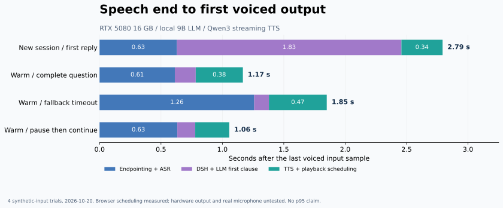

# 实验记录与验证边界

本页归纳选择过的方案和目前有证据支持的结果。完整会话历史保留在本地工作区；本仓库内的端到端原始测量可以独立查看和重画。断轮实验另归档了 4106 条标签和数值分数，可重新计算主要指标；语料文本、录音与权重不随仓库分发。

## 实验矩阵

| 实验 | 比较或问题 | 观察 | 决定与边界 |
|---|---|---|---|
| 初始复现 | Windows 方案迁移到 Linux / RTX 5080 | FunASR、OmniVoice、DSH 与本地 LLM 跑通 | 后续默认已换 Qwen3；初始数据不是当前版本承诺 |
| 首轮与数字人开关 | 第一轮不朗读、默认开关覆盖服务端 | 修改历史基线与开关同步后可正常朗读 | 真实 DUIX 尚未测过 |
| 切句 | 列表合并为长音频、流式前缀变化 | 换行、首段逗号、60 字上限及保留末尾换行修复 | 自动测试覆盖；现场模型未按指令生成列表，不把它记为列表UI验证 |
| Smart Turn v3.2 | CPU int8 与 fp32，中文是否适用 | 官方中文929条上fp32准确率90.53%，int8为86.22%；全是Google合成音 | 真人朗读停顿判完过多，不选作默认 |
| 标点与小模型 | 三个ct-punc、Qwen3/Qwen3.5小模型、9B是/否判定 | 开放user轮结束概率的Qwen3-0.6B在合成口语文本上表现较好，CPU bf16约30ms | 选作实验性文本断轮；不是校准置信度，不能外推真人表现 |
| 预录缓冲 | 静默时间是否都随下一句上传 | 35秒静默后只留约0.52秒，未见超长422 | bounded pre-roll保留在生产录音器 |
| 插话 | 检测前约0.4秒输入丢失 | 保留1秒缓冲后，合成输入开头识别完整 | 外放AEC与真人麦克风仍待测 |
| 9B显存 | 模型视觉部分导致部分层CPU卸载 | 去掉视觉部分的本地别名可完整驻留GPU | 普通ollama pull模型不一定有相同占用 |
| 流式TTS | OmniVoice整句与Qwen3分块 | 可边生成边播放，整卡历史占用约12.6GB，原约14.7GB | 首声没有证明持续更快，偶发首块长尾仍存在 |
| DUIX替身 | 分段播放、轮询和刷新后重播 | 替身链路跑通并修复轮询与历史处理 | 不代表实际口型、生成速度或显存达标 |
| TTS 同卡争用 | 未加载、仅驻留、并发生成，各 20 次 | 首有声块到达中位数 184.7 / 185.2 / 313.1ms；仅驻留仍有一次 1906.1ms | 支持并发拖慢；长尾未定位，不等于完整对话已加速 |
| 有效首句切分 | 四回答、三策略、每单元三次，36轮/96段请求 | 当前/较晚逗号/完整首句的音频可用中位225/286/238ms | 保留当前规则，复制任务重放不是DSH端到端 |
| TTS 内部长尾 | 独立模型40seed与一次重放 | 原始首块约98ms，seed16处理器首块1217ms；前导静音约4.58s音频 | 复现一种生成静音等待机制，不能追认旧1906ms样本同因 |
| 离线尾部保护 | 只剪超过1秒的低幅度段尾，保留300ms | 四段受影响录音各移除约5.1–5.3s，裁剪后ASR匹配 | 非流式上线收益；软声尾音、回听和取消尚待验证 |
| 流式保护 v1/v2 | 有界缓存、正常EOF处理、取消/超限放行 | v2 对旧77条/137段及新104条输出重放；具有时序的数据未新增估算欠载或推迟首声 | 独立原型已实现，未接生产；轻声误裁仍存在，见[结果](experiments/2026-10-20-stream-guard/RESULTS.md) |
| Qwen3-TTS 0.6B/1.7B | 同音色同引擎，初始各12条加新文本各40条 | 新文本首有声中位100.2/110.9ms，增量显存3629/5653MiB；各39/40转写匹配 | 保留0.6B；未测听感、9B并发、完整DSH，不把参数量当收益 |

## 严格尾部保护与取消

[安全性验证结果](experiments/2026-10-20-tail-safety/RESULTS.md)：严格数字零候选在181条/241段归档中零裁剪，受控弱声非零样本完整；旧幅度规则在弱声挑战失败。异步慢流与3次真实HTTP取消已测，未接生产或浏览器。决定不部署，不能将保存所有非零样本解释为已解决真实长尾。

最新[真实播放器与完整链路验证](experiments/2026-10-20-player-validation/RESULTS.md)：正式31项播放器、17轮真实DSH。快速路径baseline/阈值3为1.104/1.119秒，兜底为1.840/1.889秒，每单元4轮；首轮3.753秒单列。真实两段异常播放9.428→4.497秒，但没有首声加速结论。6条受控弱尾中旧阈值99均误裁，阈值3保留已知语音；更弱反例仍存在，人工回听pending，生产未部署。不能用该阈值3消融覆盖严格数字零方案的安全边界。

## 中文断轮选择

数据包括 [Smart Turn v3.2测试集](https://huggingface.co/datasets/pipecat-ai/smart-turn-data-v3.2-test) 的929条中文合成音、[FLEURS](https://huggingface.co/datasets/google/fleurs) cmn真人朗读，以及 [turn_detection_3k_zh](https://huggingface.co/datasets/justpluso/turn_detection_3k_zh) 的2544条合成对话文本。最后一套是模型生成的文本，不是真实语音对话。

最终FLEURS整理采用Silero分段：409条完整音频，224个至少500ms的内部停顿切点。早期RMS裁剪会丢失较轻的句尾音节，旧裁剪结果不应与新结果混合统计。

在合成对话文本上，Qwen3-0.6B开放user轮的结束分数AUC为0.954；阈值0.2时，46.9%的完整发言被提前放行，1.8%的未完发言被误放。相比之下，完整短句也常被保守地判未完，走1200ms兜底。

真人朗读中，逗号处的语义可以独立成立，但说话者仍会继续读。现策略模拟的平均等待约0.89s、句中被截断的句子约9.5%；固定1.0s等待约6.6%。这不支持“语义断轮一定优于简单静音计时”的结论。完整语音对话需要真人录音继续验证。

已从既有实验快照导出标签与数值分数，包含 Smart Turn fp32、选用的 Qwen3-0.6B 和三个标点模型。[指标表](experiments/2026-10-19-turn/RESULTS.md) 可由 [归档数值](experiments/2026-10-19-turn/scores.json) 重新计算；[数据说明](experiments/2026-10-19-turn/README.md) 解释分母、别名和范围。重算统计不需要模型；重新跑推理仍需原始语料、裁剪过程和对应权重，不等于完整基准已可一键重跑。int8 和其他未归档候选模型的数字仍按历史记录理解。

## 端到端延迟



2026-10-20，在真实DSH页面，合成音频送入实际AudioWorklet/MicRecorder，再经过语义断轮、ASR、DSH提交、本地9B回复、流式TTS和实际ReplySpeaker调度。原始测量构建的插件SHA-256为 `4519465705834132671dced9ddd784d9ad519355754ac02e985cb5dbc2e28f74`，早于本次模块整理；本轮CPU测试不代替整理后的GPU端到端复测。

| 用例 | 断轮/ASR完成 | DSH/LLM第一句 | TTS至首声 | 合计 |
|---|---:|---:|---:|---:|
| 新会话首轮 | 0.630 s | 1.828 s | 0.335 s | 2.793 s |
| 热运行完整问句 | 0.613 s | 0.170 s | 0.384 s | 1.167 s |
| 热运行走兜底 | 1.259 s | 0.120 s | 0.471 s | 1.850 s |
| 句中停顿后继续说 | 0.633 s | 0.146 s | 0.277 s | 1.056 s |

- 起点：输入最后一个绝对幅度至少0.01的采样。
- 终点：输出AudioBuffer第一个达到同样阈值的采样在浏览器AudioContext上的预定播放时刻。
- 包含浏览器到远程GPU主机的网络往返；不含扬声器/耳机硬件输出延迟。
- 首轮没有控制模型缓存，不能称为严格冷启动；四轮不足以给出稳定p95。

[原始JSON](experiments/2026-10-20-e2e/results.json) · [假麦克风计时脚本](experiments/2026-10-20-e2e/instrumentation.js)

计时脚本仅供本地开发测试，会替换该页面的getUserMedia和网络/播放钩子。不要把它加入发布bundle；重新加载页面会移除钩子。运行四轮后在网页开发者工具读取 `__fakeMic.report()`；避免多个DSH标签页重复朗读。参考输入包括天气问句、吃饭问句、简短笑话请求，以及未完短语加600ms附加停顿再续说。

## 预录回归

独立录音器测试页使用40ms帧与真实bridge接口；这里的时间只到识别文字可用。

| 用例 | 文字可用 | 结果 |
|---|---:|---|
| 静默35秒后完整问句 | 613 ms | 缓冲仅16640字节，约0.52秒；HTTP 200 |
| 同句固定1800ms基线 | 1853 ms | 识别完整 |
| 未完短语 | 1345 ms | 走兜底 |
| 停顿后继续说 | 622 ms | 只提交一轮 |

[原始JSON](experiments/2026-10-20-preroll/results.json)。0.61秒不是完整语音回复延迟。原版“约2.5–2.9秒”是早期估计，不是这四轮的同条件对照组。

## 如何重新生成图表

```bash
python -m pip install -r requirements-dev.txt
python scripts/render_figures.py
python scripts/summarize_turn_eval.py
```

两个脚本只读取仓库内 JSON，不下载模型、不访问 GPU。前者输出 SVG 和 PNG，后者输出断轮统计表。更换数据后应同时更新本页的日期、构建与测量条件，不把旧数值留在 README。

## 下一轮需要记录

2026-10-20 的[首句策略对照](experiments/2026-10-20-first-clause/RESULTS.md)与[内部长尾追踪及离线裁剪](experiments/2026-10-20-tts-tail/RESULTS.md)已完成。切句没有稳定的新赢家，更值得继续的是流式尾部保护原型及真人回听。当前默认与生产代码未改。

2026-10-20 已完成[使用价值判断与 TTS 争用实验](experiments/2026-10-20-tts-contention/RESULTS.md)：先验证小成本诊断值得做，再按预写协议执行 60 次正式测量，原始数值、环境、图和脚本均已归档。没有修改生产代码。13 段 ASR 抽查去标点后匹配，但真人使用价值仍待实际输入验证。

先用真人麦克风覆盖耳机与外放、短句与长句、自然犹豫和播放中插话。逐次记录断轮、LLM首句、第一段有声输出，以及误断句、误打断和漏掉开头的情况。之后再扩大样本并报告分位数；语音主链路、真实数字人和全双工模型分别验证。

## 生成端EOS与采样

[2026-10-20结果](experiments/2026-10-20-generation-end/RESULTS.md)：48条诊断、24条新文本、2条无追踪控制。重复惩罚1.15使已知段尾5355.5→79.1ms且自然EOS；新文本没有总体首声收益，ASR均9/12，一改善一退化，未回听。降低温度出现撞上限。保留独立候选，不部署，不启用幅度裁剪。

## 1.15 扩展内容验证

[108条新对照](experiments/2026-10-20-repetition-validation/RESULTS.md)：三类各18对，全部自然EOS、无超过1秒尾部。默认/候选首有声PCM中位183.0/100.5ms，ASR各47/54；轻声结尾组18/18与17/18，存在待听退化。54对全量回听包与优先8对已整理，人工评分pending，生产未部署。

## 生成布局、参考上下文与出块

[新对照及原始证据](experiments/2026-10-20-generation-layout/RESULTS.md)：首轮80条遇到并行数字读法进程，单独保留，随后按同输入复跑80条且逐条未检测新GPU进程。正式全部自然EOS，新文本每策略12条首有声PCM中位默认/逐步文本/仅向量/chunk2为143.0/101.2/92.2/138.3ms；不是HTTP或完整DSH延迟。chunk2的20对声学码与基线全同，生成总时长反而增加；文本布局变化未消除异常。仅向量把已知5.356秒尾部降到83.4ms，但另一问句仍有2.179秒前导，音色和韵律未听检，不部署。

两轮80对声学码及WAV逐字节相同，一条ASR却从两编辑变零；同PCM追加三次为0/0/2编辑。此波动未定位，不将单次识别差异直接当成TTS内容损失，也不把一次全匹配当作听感通过。生产继续不裁剪。

## 仅说话人向量盲听材料

[32对盲听及浏览器验证](experiments/2026-10-20-xvector-listening/RESULTS.md)：复用正式20对，补充6种自然结尾×2seed，共新增24条生成，全部自然EOS、无错误或新增GPU进程。页面保留原音和同一参考，A/B逐对随机且左右各半，优先8对覆盖轻声词、重复及长句。65音频解码和原文件哈希一致；播放、尾词定位、停止、筛选、评分刷新恢复和32条JSON导出已测，测试分数已清回pending。用户已告知试听并导出，评分原件待接入，见[分析口径](experiments/2026-10-20-xvector-listening/RATING_IMPORT.md)。生产没有采用候选、1.15或裁剪，不能把页面技术通过写成音质通过。

## 数字读法规范化

[48条独立对照](experiments/2026-10-20-number-reading/RESULTS.md)：默认1.05，编号精确序列匹配12/24→23/24，日期时间两组各12/12。留单次少位疑点、规范化一条5.413秒段尾，总生成变慢。无达到多seed持续失败门槛的人工回听项目，不等于内容最终通过；未采用、未部署。


## 数字疑点复核与仅向量自动对照

[冻结协议和结果](experiments/2026-10-20-numeric-recheck/RESULTS.md)：原PCM 30次复核中，110022疑点20次全10022，同seed原始数字输入5次全110022，长尾样本5次全100200300。默认重放两个原PCM字节相同；长尾197/360帧自然EOS，原始模型尾5396.2ms、PCM尾5412.8ms，末3秒含非零残留，并非WAV全零填充。只切向量同seed尾120.7ms，未裁剪；ASR无法独自区分TTS少读与稳定识别错误。

既有32对64音频各三次识别均字符匹配。新48条两模式均24/24自然EOS，无错误或新增GPU PID；诊断三次字段全匹配各5/6，配对一条仅向量稳定、一条仅默认稳定。新输入各18条，默认18/18、向量17/18；额外unparsed为“是→十”的字段边界疑点，不确定吞字。新输入首有声PCM中位184.4/91.9ms、总生成854.7/604.7ms，既有长尾5412.8→120.7ms。仅向量值得独立验证，内容/音色/韵律/天然轻声尚未共同验收；不代替完整DSH计时，也不部署、采用1.15或裁剪。资源结束核验2026-10-20：原服务及生产哈希不变，自有模型退出、GPU0%/5456MiB占用。


## 向量模式的定向识别与集成验证

[协议、结果与数值](experiments/2026-10-20-xvector-integration/RESULTS.md)：七份原PCM独立Whisper-small CPU/greedy+beam5共14项。原默认110022及向量10102020与FunASR分歧；向量110022/6619两模型均10022，默认控制也有分歧，不把共识写成听感真值。

正式12取消未见晚入播放source，但已取消排队请求仍入handler，默认已知长前导可额外占锁约1.98秒；8队列已知长尾组实际播完12.109→4.545秒，普通短句3.903→4.215秒，播放器分段间隙均50–56ms。18完整DSH含两次首次及16热轮，快速路径默认/向量1.150/1.038秒、兜底1.787/1.672秒，各4轮；8配对首段均不同，不能因果归因。额外TTS驻留与共同自有缓存清理是实验条件，模型预加载、合成输入与排定首声不等于冷启动/真人/物理声卡。保留开发与两次失败首轮，正式18/18有播放且采样数一致；生产不改、1.05与裁剪关闭保持。


## 独立取消生命周期修复（未部署）

[固定默认ICL的12取消、8队列和18DSH](experiments/2026-10-20-cancel-lifecycle/RESULTS.md)：首PCM前响应关闭→生成退出中位1948.4→63.3ms，排队取消0/2进入模型，后继短请求→首声2319.5→337.0ms。运行线程退出前持续持锁；原始块检查早于handler丢弃静音。没有改采样、自然EOS或裁剪。首声后取消31.7/50.3ms未见改善，每单元仅2次。

8对队列PCM和4对冻结DSH首句字节全同，78WAV及全部播放计数通过。18DSH含各一次预加载新会话首次3.885/3.344秒、16热轮快速1.196/1.173秒与兜底1.886/1.749秒（旧/新，每单元4轮）；混合中位1.493/1.495秒。8配对首句全不同，未证明正常对话一般提速，不能把首次差当因果收益。合成输入→AudioContext首有声排程不含物理硬件或真人。生产哈希和原进程保持、9B恢复未加载，裁剪关闭；后续已完成下述v2独立恢复压力验证，M0共锁兼容与生产替换恢复仍待验收，未部署。


## 连续取消与恢复候选 v2（未部署）

[36项HTTP、4组/8次播放器停止和独立重启](experiments/2026-10-21-cancel-recovery/RESULTS.md)均已完成。保持默认ICL/全文/chunk4/1.05、不裁剪；v2新增8元素有界队列、外部取消持锁等待、清理异常传递和显式HTTP断连清理。排队取消各臂0/2进模型，close错误消费者可见0/2→2/2，故障后请求正常；8条完整控制和2条重启控制PCM相同，81服务端/47客户端WAV核验通过。程序停止8次无晚source，本地88项和apex生命周期13项通过。

受控40ms慢发送使队列70/38→8/8，但持锁0.83/0.48→3.32/1.70秒。当前没有发送停滞期限，仍可能无限占锁，下一项先补期限与整请求预算。没有新增完整DSH、9B/真人VAD/AEC或物理首声测试；独立重启不替代生产替换/回滚。生产配置与裁剪保持，M0整体与听感未验收。执行2026-10-21、文档归档2026-10-22，环境沿用报告内最近现场快照。
