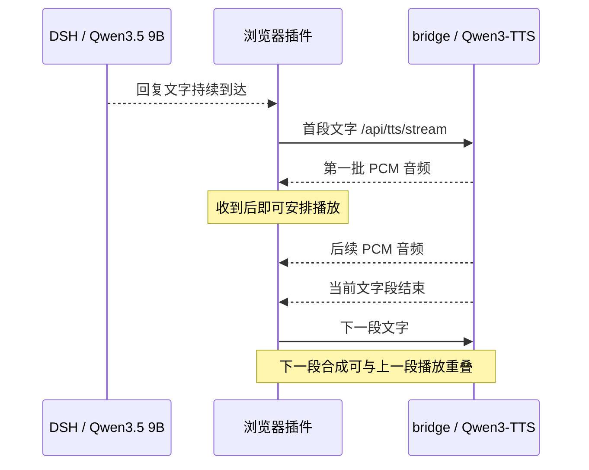

# 流式语音、当前模型与更换选择

本页解释现有 DSH 级联语音分支。原生全双工预约 Agent 是另一个方案，不能用这里的 TTS 数字替代它的延迟或效果。

## 流式指什么

一次请求已经包含可朗读的一段完整文字，但输出音频分块产生：

完整 WAV 接口要等整段合成完才返回，流式接口可在整段完成前播放。插件仍按切句发请求，并没有把每个新文字 token 都送进同一次 TTS 请求。每段结束后才能确认最后的低幅度音频是段尾，提前发到浏览器并已排定播放的音频也不能单靠服务端裁剪收回。

当前 `streaming_chunk_size=4`，模型每次解码约 320 ms 音频，handler 再分为约 32 ms 的 PCM16 小块，HTTP 接收可能合并多个小块。这些数值是**音频内容时长**，不是每隔 320/32 ms 的墙钟等待。模型速度、GPU 竞争、前导静音及网络都会影响何时有可播语音。

## 实际使用的模型

2026-10-20 在线核对：

| 功能 | 使用组件 |
|---|---|
| 语音识别 | FunASR Paraformer 中文 |
| 说完判定 | 识别文字加 Qwen3-0.6B，默认 CPU；这不是 TTS |
| DSH 主对话 | Qwen3.5 9B 去视觉版本，经 Ollama |
| 默认语音合成 | `Qwen/Qwen3-TTS-12Hz-0.6B-Base`，小雅参考音频克隆 |
| 流式推理实现 | `speech-to-speech 0.2.10` 加 `faster-qwen3-tts 0.5.4`，CUDA 图 |

生产配置为 CUDA、dtype=auto、SDPA、chunk_size=4。实际 handler 为 xvec_only=false、parity_mode=false、non_streaming_mode=true。最后这个参数是库内部生成模式；当前依然调用 `generate_voice_clone_streaming` 逐块返回音频，不能只看参数名判断 HTTP 是否流式。

Qwen 官方提供 [0.6B Base](https://huggingface.co/Qwen/Qwen3-TTS-12Hz-0.6B-Base) 与 [1.7B Base](https://huggingface.co/Qwen/Qwen3-TTS-12Hz-1.7B-Base) 克隆模型。[推理库作者说明](https://github.com/andimarafioti/faster-qwen3-tts)介绍 CUDA 图及音频分块实现；网页主分支的功能可能晚于本地 0.5.4，实际实验以归档依赖和行为为准。官方宣称或其他显卡测得的首块数字不等于本项目完整对话延迟。

## 换模型会怎么样

同参考音色、同库实测 104 条后，当前决定继续使用 0.6B。新文本每模型 40 条，首有声块中位数 0.6B 为 100.2 ms、1.7B 为 110.9 ms；1.7B 某条句子更快，但整体收益依赖文本。额外进程显存约从 3.54 GiB 增至 5.52 GiB。详细方法、所有失败及图见[模型和保护器实验](experiments/2026-10-20-stream-guard/RESULTS.md)。

| 选择 | 已有证据 | 后续要验证 |
|---|---|---|
| 继续 0.6B Base | 新文本组首声及生成速度更快，显存较少；已复现个别生成静音长尾 | 真实回听、长会话、参考音频/采样对照 |
| 1.7B Base | 在含已知慢 seed 的诊断组更稳，新文本总体没有首声收益，显存增加约 2 GiB | 是否更自然、发音更准确；与 9B 共存及并发速度 |
| 恢复 OmniVoice | 之前跑通过，现服务停用、音色已移出选择列表；当前适配整句完成后返回 | 按同一新协议复测；历史数字不代替此次对照 |
| 其他 TTS 模型或云接口 | 本轮未部署、未测量 | 中文、音色权限、流式/取消契约、真实首声、成本与资源 |

更换模型会同时改变音色相似度、节奏、发音、音频长度和资源。更大的模型可能有质量价值，但本轮 ASR 检查无法判断听感，不能宣布音质更好。复用同一接口也不保证首声更快，特别是仍与 9B 共享 GPU 时。

## 本轮优化到了哪一步

已实现未启用的 `bridge/stream_tail.py`：正常结束时清理异常长的低幅度段尾，保留 300 ms，缓存上限 256000 字节，支持取消和超限放行。旧包时序和新模型输出重放均未新增估算欠载或推迟首声，异常样例能删除约五秒尾巴。

幅度不能可靠区分轻声尾词与静音，已用契约测试记录误裁反例。因此生产继续关闭该候选，后续优先回听和实际播放器验证。这项候选改善的是异常句尾等待，不能解决模型生成前导静音已经花掉的计算时间。

随后完成[31项实际播放器与17轮DSH测试](experiments/2026-10-20-player-validation/RESULTS.md)：旧阈值99在6条受控轻声结尾全部误裁；新增阈值3消融在本组保留尾语音，但更弱输入仍可失败。异常两段实际播放9.428→4.497秒；快速路径首声中位1.104/1.119秒、兜底1.840/1.889秒，未证明首声加速。回听页及样音已制作，人工评分仍pending，生产不启用裁剪。另有[严格数字零方案](experiments/2026-10-20-tail-safety/RESULTS.md)，能保证非零样本保留，却未缩短归档的真实长尾；两者取舍不能混称为已安全修复。

## 继续从生成条件排查

[生成布局对照](experiments/2026-10-20-generation-layout/RESULTS.md)完成正式80条，另保留受GPU干扰的首轮80条。新文本每策略12条，默认/逐步文本/仅说话人向量/chunk2首有声PCM中位143.0/101.2/92.2/138.3ms。仅向量不再使用ICL参考声学上下文，会改变音色与韵律条件；短尾和ASR匹配不足以说明克隆品质不变。

chunk2的20对声学码序列全同，原始第一块从约101到66ms，但新文本首有声只少4.7ms，整句生成中位922.2→1042.9ms，已知静音仍在。当前保留chunk4、全文预填、ICL及裁剪关闭。下一项先听向量条件与ICL的差异；若音色退化，再单独比较同音色的参考片段长度/原有静音，不把输出幅度裁剪改称模型修复。上述时间排除HTTP、9B和浏览器，未替换完整DSH数字。

该回听步骤现已准备[32对单盲材料](experiments/2026-10-20-xvector-listening/RESULTS.md)，保留20对并新增12对自然结尾，含原参考、优先8对和音色/韵律/收尾评分。材料与播放界面验证通过；用户已告知试听并导出，评分原件尚待接入，质量结论未定。原音频没有额外裁剪或响度处理，末尾按钮只定位；未部署向量条件，也没有用新12条的较短尾部替代音色验收。

## 向量条件的数字与长尾复核

[本轮48条生成及366次重复复核](experiments/2026-10-20-numeric-recheck/RESULTS.md)发现原110022疑点20次稳定识别成10022，仍不能区分TTS或ASR。默认同文本/seed的PCM与原疑点及长尾逐字节相同；5.413秒尾部在模型原始统计中也存在，向量同seed降为0.121秒、197→33帧自然EOS，证明这是可受参考条件影响的生成路径，无新增裁剪。

新编号每模式18条首有声PCM中位184.4/91.9ms、完整生成854.7/604.7ms；三次字段全匹配默认18/18、向量17/18，后者一条“是→十”字段边界unparsed，未确认为数字漏读。诊断各5/6且失败seed不同。既有64条音频各三次ASR全匹配，但不等于音色、韵律和天然轻声验收。保留独立候选，生产ICL、chunk4、1.05及裁剪关闭保持；下一步只针对具体疑点，并在隔离入口验证取消/队列与完整DSH收益。

## 完整链路的有限收益与取消问题

[本轮独立入口](experiments/2026-10-20-xvector-integration/RESULTS.md)直接调用部署版tts_stream/_synthesize_iter，完成12取消、8队列、18DSH。热运行每路径/模式4轮：快速默认/向量1.150/1.038秒、兜底1.787/1.672秒；首次模型预加载3.598/1.880秒，各仅1条。8配对首段全部不同，两路径混合中位差仅31.3ms，不将首次或分路径差当稳定因果收益。独立实验额外驻留TTS，必须在自有模型释放锁前清闲置缓存，两边相同；绝对值不替换原生产17轮。

长尾两段实际播完12.109/4.545秒，普通短句3.902/4.215秒；更短不自动等于韵律更好。已取消排队请求仍开始handler计算，已知默认前导再占约1.98秒，向量也未修这个生命周期问题。Whisper使两个原数字标记出现识别分歧，向量110022/6619仍获两模型相同少位转写，继续未确认。生产默认ICL/1.05、裁剪关闭；下一项优先独立取消修复和新冻结DSH验证，音色、韵律及天然轻声保持未验收。

## 独立取消生命周期修复（未部署）

[固定默认ICL的12取消、8队列和18DSH](experiments/2026-10-20-cancel-lifecycle/RESULTS.md)：首PCM前响应关闭→生成退出中位1948.4→63.3ms，排队取消0/2进入模型，后继短请求→首声2319.5→337.0ms。运行线程退出前持续持锁；原始块检查早于handler丢弃静音。没有改采样、自然EOS或裁剪。首声后取消31.7/50.3ms未见改善，每单元仅2次。

8对队列PCM和4对冻结DSH首句字节全同，78WAV及全部播放计数通过。18DSH含各一次预加载新会话首次3.885/3.344秒、16热轮快速1.196/1.173秒与兜底1.886/1.749秒（旧/新，每单元4轮）；混合中位1.493/1.495秒。8配对首句全不同，未证明正常对话一般提速，不能把首次差当因果收益。合成输入→AudioContext首有声排程不含物理硬件或真人。生产哈希和原进程保持、9B恢复未加载，裁剪关闭；后续已完成下述v2独立恢复压力验证，M0共锁兼容与生产替换恢复仍待验收，未部署。

## 连续取消与恢复候选 v2（未部署）

[36项HTTP、4组/8次播放器停止和独立重启](experiments/2026-10-21-cancel-recovery/RESULTS.md)均已完成。保持默认ICL/全文/chunk4/1.05、不裁剪；v2新增8元素有界队列、外部取消持锁等待、清理异常传递和显式HTTP断连清理。排队取消各臂0/2进模型，close错误消费者可见0/2→2/2，故障后请求正常；8条完整控制和2条重启控制PCM相同，81服务端/47客户端WAV核验通过。程序停止8次无晚source，本地88项和apex生命周期13项通过。

受控40ms慢发送使队列70/38→8/8，但持锁0.83/0.48→3.32/1.70秒。当前没有发送停滞期限，仍可能无限占锁，下一项先补期限与整请求预算。没有新增完整DSH、9B/真人VAD/AEC或物理首声测试；独立重启不替代生产替换/回滚。生产配置与裁剪保持，M0整体与听感未验收。执行2026-10-21、文档归档2026-10-22，环境沿用报告内最近现场快照。
