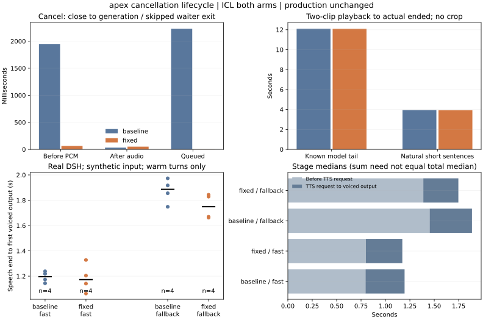

# 取消生命周期修复：独立入口验证

2026-10-20（America/Chicago）。按[冻结计划](PLAN.md)固定默认ICL，只比较旧生命周期和独立修复版。生产配置、bridge、插件和裁剪开关没有更换；本报告不把仅向量收益混入取消修复。

## 根因与实现

原endpoint的后台task进入infer_lock后直接调用handler，排队时已经断开的请求仍会启动。_synthesize_iter只在handler输出PCM后检查事件；handler会丢弃前导静音，因此已取消请求仍可能先生成25个原始块、约2秒才看见事件。没有证据把主要延迟归因于网络断连检测周期。

[StreamJob](../../../scripts/tts_cancel_lifecycle.py)只用于独立入口：排队阶段可取消等待task；进入锁后同步检查事件，再启动线程。运行中只设置事件，不取消持锁task，实际生成线程退出后才释放锁。ContextVar把每请求事件带入线程，原始音频块的next前后检查，早于handler的前导处理；finally关闭内层生成器并重置上下文。没有更换chunk4、采样、token预算、自然EOS或音频处理规则。

[独立适配器](../../../scripts/cancel_validation_server.py)在私有handler实例上装入原始块检查；baseline继续调用原部署endpoint。HTTP断连由当前StreamingResponse驱动body的finally；验证环境为Uvicorn0.54.0、Starlette1.9.0。取消无法中断正在执行的CUDA操作，仍需等当前原始块生成返回。它不是跨后端硬实时保证，OmniVoice原子调用未改变。

CPU用阻塞生成器模拟正在执行的GPU调用，先复现等待不退出/静音全部耗完，再验证排队撤走、首块前退出、线程退出前持锁、正常字节、异常与上下文清理，以及task尚未调度就取消。共享计时器另验证“根本未开算”不能伪造producer耗时。完整81项Python通过。

## 数据与计时

12取消、8实际队列、四条冻结DSH首句×两臂HTTP控制及18完整DSH全部完成。[共享报告工具](../../../scripts/report_cancel_lifecycle.py)已导出[原始数值和分组摘要](data/summary.json)，[独立核验](data/verification.json)逐一核对78份WAV、模型调用边界和播放采样。

取消耗时使用同一服务端时钟，从响应消费者关闭到后台退出；排队修复版没有producer，采用worker完成时刻，并单独核对模型从未启动。播放器stop→ended和后继请求→首有声采用页面内时钟。未开始播放的条目不虚构停播耗时。

完整DSH从合成输入最后有声采样排定时刻，到AudioContext回复首有声采样排定时刻，含AudioWorklet、turn/STT、DSH、9B/32K、切句、HTTP和ReplySpeaker，不含声卡/耳机、真人或外放回声。9B预加载1423.4ms单列，模型size_vram=size=6315069931、context32768；首次请求不是严格冷启动。额外实验TTS与两臂共同的自有闲置缓存清理仍是隔离条件。

## 取消：解决排队开算与首PCM前长等待

每单元仅2次，中位数；服务端计时不包含客户端到服务端的网络传播。

| 情形 / 指标 | 旧生命周期 | 修复版 |
|---|---:|---:|
| 首PCM前，消费者关闭→生成退出 | 1948.4ms | 63.3ms |
| 首source后250ms取消，关闭→生成退出 | 31.7ms | 50.3ms |
| 已取消排队请求，关闭→后台退出 | 2231.7ms | 0.365ms（撤走等待，无生成线程） |
| 已取消排队请求实际调用模型 | 2/2 | 0/2 |
| 排队取消后新短请求→首有声排程 | 2319.5ms | 337.0ms |
| 首source后取消，播放器stop→最后ended | 1.45ms | 7.0ms |

12/12无取消后新增source。首PCM前，旧版每次生成25个原始块，修复版每次仅1个，后台退出范围分别1919.8–1977.0和35.6–91.0ms。修复后的两个排队请求既没有拿到锁，也没有进入handler、生成原始块或发送PCM；不是只把音频丢掉而继续算。

所有进入生成的请求，其producer退出都不晚于锁释放；任务集合最终归零。首声后的退出时间没有显示改善，两个重复不足以认定稳定退化或改进。主收益在排队取消与尚无PCM的前导阶段。

## 未取消队列和固定首句保持原音

8个队列条目的两段输出形成8对同文本/seed PCM，全部WAV字节相同；浏览器排定采样数与HTTP接收相同。已知长尾组实际播完中位12.106/12.095秒，普通两短句3.935/3.919秒。纯排程边界间隙中位约51–55ms，已知长尾的有声间隔仍约5.53秒，修复没有缩尾或解决自然EOS长尾。

另四条冻结的上轮DSH首句，8次无取消HTTP控制的PCM全同。首有声PCM可用时间逐对为309.5/308.8、223.1/223.7、227.1/223.5、139.6/139.8ms（旧/新）。这是同一文本和seed的内容及生成回归，未显示正常首声提速；不含DSH、输入断轮或物理播放。

## 完整DSH：正常对话延迟没有建立一般收益

| 说完→AudioContext首有声 | 旧生命周期 | 修复版 | 每臂样本 |
|---|---:|---:|---:|
| 模型已预加载，新会话首次 | 3.885秒 | 3.344秒 | 1 |
| 热运行，快速路径中位 | 1.196秒 | 1.173秒 | 4 |
| 热运行，1.2s兜底中位 | 1.886秒 | 1.749秒 | 4 |
| 两路径混合热运行中位 | 1.493秒 | 1.495秒 | 8 |

热运行范围旧版1.144–1.973秒，修复版1.063–1.843秒。18/18有输出，0错误，采样计数全同。快速路径首TTS请求前中位795.9/798.9ms、请求→首声400.0/374.0ms；兜底为1452.8/1388.0和433.5/359.0ms。分段中位之和不一定等于总中位。

8个热运行配对的LLM首句全不同，两个首次首句也不同。文本、生成长度、历史与调度构成混杂；没有把0.541秒首次差或0.137秒兜底差归因取消修复。正常热轮没有取消行为，混合中位只差约2ms，和四条同文控制一致：**本轮证明取消后资源更快交还，未证明正常对话第一声整体更快。**



## 决定与下一步

保留StreamJob为独立候选，值得进入M0兼容与恢复验收。下一项在同默认音色下扩展快速连续插话、慢客户端、断网/重连和异常清理；先证明真实部署模型共锁、重载与恢复，再考虑另行授权部署。实际麦克风/AEC、硬件首声、音色与天然轻声仍未验收。仅向量与1.15均未采用，裁剪继续关闭。

81项Python、Ruff/格式、JS构建/语法、源码镜像和49份文档链接通过。公共数据独立复算一致；旧向量实验的summary也字节一致。执行源码、依赖版本、模型及78份PCM核验结果见data和executed。

环境最近核验2026-10-20 21:47 CDT：生产bridge d8b527cf…、插件45194657…、配置68dcd0a7…与开始一致，原3504737/408436保持，STT/TTS/turn健康。自有模型退出、9B恢复未加载、Ollama为空，GPU0%/5456MiB占用/10353MiB空闲；实验8766无监听，自有本机18766已撤回，原8765、他人本机8766和盲听页保留。apex实验约9MB。不提交、推送或重启其他服务。

## 执行与复算

run-1/run-2在导入前因实验工具缺stream_tail依赖退出，无模型加载或测试数据；将现有模块仅复制进独立tools后，正式数据写run-3。该旧fixture模块被proxy导入，实际owned TTS路由没有使用TailGuard。未覆盖失败日志，也未给生产安装模块。

原始PCM、逐字回复、浏览器事件与完成截图留工作区samples/2026-10-20-cancel-lifecycle和apex的~/voice-ai/experiments/20261020-cancel-lifecycle；公开只保留数值、哈希与源码。第一次新会话原件和第二页面17轮原件分别保留，合并不相减跨页绝对时钟。

```bash
# 公开数值可独立复算，不需模型或apex
python scripts/report_cancel_lifecycle.py --folder docs/experiments/2026-10-20-cancel-lifecycle
# 本地持有原始证据时，另核对模型调用、78份原PCM及环境恢复
python scripts/verify_cancel_evidence.py --private ../samples/2026-10-20-cancel-lifecycle --public docs/experiments/2026-10-20-cancel-lifecycle
```
