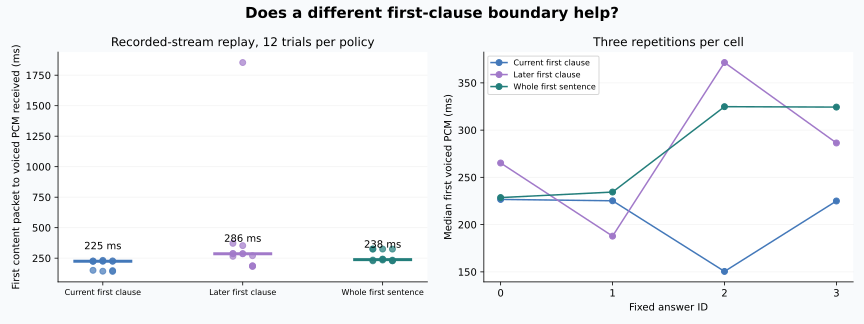

# 有效首句切分实验结果

2026-10-20，apex / RTX 5080。四段固定回答、三种切分策略、每单元三次，共36轮完整回答、96次TTS段请求。先按[协议](PLAN.md)录制9B逐字复制任务的内容到达时间，再重放相同时间线；四次复制均与固定全文完全一致。

**决定：保留当前首段切分规则。** 两个候选没有显示出足够一致的首声收益，较晚逗号切分还遇到长尾；没有修改插件或默认配置。

## 速度与代价

时间零点是录制任务首个内容块，不是用户说完。LLM在TTS重放期间仅驻留，不额外制造生成负载。这轮隔离切分因素，不测真实DSH或浏览器。

| 首段策略 | 样本 | 文本就绪中位数 | 首有声PCM到达中位数 | 理想播放器首声估算 | 全文合成中位数 |
|---|---:|---:|---:|---:|---:|
| 当前：至少5字后的首个逗号 | 12 | 41 ms | **225 ms** | 250 ms | 2718 ms |
| 候选：至少18字后的逗号 | 12 | 94 ms | 286 ms | 326 ms | 2788 ms |
| 候选：完整首句 | 12 | 136 ms | 238 ms | 278 ms | **2586 ms** |

完整首句少一次段请求，全文合成中位数约少132ms，但首有声PCM并未更早，只有四种回答，尚未评估主观韵律。较晚逗号比当前策略约晚61ms；不能为了省请求数量直接改变默认。



每单元只有三次，不报告稳定p95。当前规则在四种回答中的三种中位首声更快，另一个回答较晚逗号更快。没有统一获胜的新边界。[逐次数据](data/trials.jsonl) · [统计表](METRICS.md) · [摘要](summary.json)

## 输出完整性与停顿

三种策略均拼回相同全文。实验中的“当前规则”在四个输入上与实际插件 `splitSentences` 输出核对一致；这是有限输入验证，不宣称本脚本实现完整Markdown/长句切分器。

36段全文经当前FunASR识别，34段去标点后完全匹配。另两段为“再/在”和“试/始”同音字差异，不能直接归因为TTS发音错误。没有按识别结果删除延迟样本。[全文转写](data/asr_check.json)

较晚逗号组有一次首有声音频到达1854ms。另有三段完整回答达到13–15秒，检查每个TTS段后发现其中一个段尾有约5.4–5.6秒连续低幅度音频。转写可以完全正常，但声音播放仍会等待。

| 正式轮次 | 异常段尾低幅度长度，1%幅度阈值 | 全文生成音频长度 |
|---|---:|---:|
| 17 | 5567 ms | 15.488 s |
| 23 | 5406 ms | 13.088 s |
| 34 | 5389 ms | 14.784 s |

这些都在较晚逗号候选中；本轮当前策略12段没有同类超过1秒的段尾，因此不能把3/36当作当前默认配置的发生率。另一独立固定seed实验也出现长尾，说明机制不限于这一个切分候选。

低幅度分析只是采样阈值检查，不是人工静音标注。第14轮还有约1.2秒句中低幅度区间，不属于段尾，不能用尾部裁剪处理。[逐段分析](data/pause_analysis.json)

## 新增离线尾部保护验证

按测量后补充协议，仅对末尾低于0.003幅度且长于1秒的区间处理，保留300ms。没有修改开头、句中停顿和正常短尾。

上述三段分别少了5262、5094、5075ms低幅度音频。用原来的网络包到达时间重算理想播放器，估算播完时间也分别减少约5.26、5.09、5.08秒。下一段请求仍保持原来的发起时间，没有假设模型生成更快。

三段裁剪后的自动转写与原文去标点后均一致；被保留的各段PCM前缀逐样本不变。[裁剪记录](data/crop_results.json) · [裁剪后转写](data/crop_asr_check.json)

该结果只说明离线候选值得继续实现和验证。真实流式实现需要处理已排定音频、缓冲上限、取消、软声尾音和噪声；ASR一致不等于主观听感无损，也不是已部署的5秒加速。

## 复现与边界

主机脚本：`scripts/bench_first_clause.py --out /path/to/new-run --repeats 3`。它要求本项目LLM初始未加载，结束后恢复；需要同一模型、当前bridge和参考音色。输入时间线及完整回答在[环境清单](data/manifest.json)。生成音频留在apex `~/voice-ai/experiments/20261020-first-clause/main-01/`，没有复制进公开仓库。

CPU重算：

```bash
python scripts/report_tts_followups.py \
  --clause docs/experiments/2026-10-20-first-clause/data \
  --tail docs/experiments/2026-10-20-tts-tail/data
```

理想播放器仅按PCM块到达和采样长度排队，不包含真实AudioContext调度、设备缓冲或扬声器。自动估算的欠载中位数为零，也不能证明外放听感没有停顿，模型生成的低幅度尾巴仍会播放。

结束[核验](data/postcheck.json)：STT/TTS/turn健康，LLM恢复未加载，生产bundle与bridge内容哈希不变。未带token访问DSH返回预期401，未绕过认证，也没有把该请求当完整UI测试。生产服务没有重启，未提交或推送。

后续优先实现独立、可测试的流式尾部保护原型并回听，保留当前切句；真人耳机/外放验证仍待进行。
