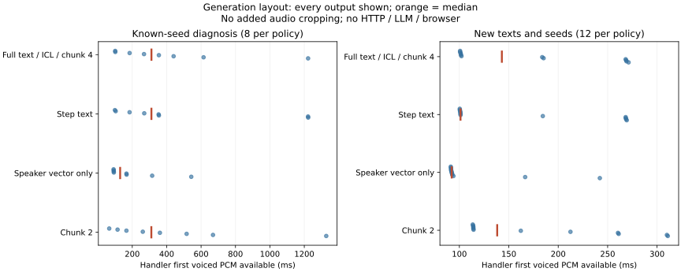

# 生成布局对照：静音由生成路径决定，出块减半没有解决

2026-10-20，apex RTX5080 16GB，同款Qwen3-TTS-12Hz-0.6B-Base、小雅参考和原CUDA推理库。裁剪全程关闭，handler原有前导处理保留。没有修改生产包、参数、配置或服务。

完成受干扰首轮80条与正式复跑80条，各另8次预热。正式记录均自然EOS，没有撞token上限或运行错误，每条前后均未发现新GPU进程。决定继续保留生产默认全文预填、ICL参考、chunk4，不部署新参数或裁剪。只用说话人向量是值得回听的候选，尚不能认为音色与韵律等价。

## 方法与边界

按[预写协议及资源修订](PLAN.md)，逐步喂文本、只用说话人向量、chunk4→2三项各自只改一个变量；其余维持默认temperature0.9、repetition1.05。没有叠加上一轮1.15，也不降低token上限或添加EOS停止器。

已知seed组每策略8条，新文本新seed组每策略12条，共80条，另8次预热不计分。第一轮80条在中途遇到数字读法实验进入GPU，完整另存[data/interfered-run](data/interfered-run)，不能用于正式耗时。本轮在该进程自行退出后原样复跑；没有停止他人进程。复跑加入每条前后新GPU进程检查。检查本身不在生成计时内；不把没有新PID等同主机全程独占。

首有声PCM：调用生产同款handler到返回第一个绝对PCM幅度至少328的16kHz块。原始第一块与第一有声块另计，24kHz幅度0.01。总生成到耗尽及CUDA同步完成，含本轮码序列记录开销，不含后续ASR、HTTP、LLM和浏览器，不是完整说完到首声，也不是严格冷启动。

低幅度前导/段尾只用作诊断：原始阈值0.003，PCM阈值99/32768。它不能鉴别人声，更没有用于删样本。音色、天然轻声和韵律必须回听；ASR精确匹配或自然EOS都不代表听感无损。

## 正式新文本结果：每策略12条



| 单变量策略 | 首有声PCM中位 / 最大 | 总生成中位 | 段尾总时长 / 最大 | ASR匹配 |
|---|---:|---:|---:|---:|
| 默认全文预填、ICL、chunk4 | 143.0 / 271.2ms | 922.2ms | 2.725s / 595.0ms | 12/12 |
| 仅逐步喂文本 | 101.2 / 269.3ms | 909.8ms | 2.655s / 607.6ms | 12/12 |
| 仅说话人向量，关闭ICL声学上下文 | 92.2 / 242.1ms | 790.9ms | 0.893s / 168.2ms | 12/12 |
| 仅chunk4→2 | 138.3 / 310.8ms | 1042.9ms | 2.726s / 595.0ms | 12/12 |

新文本两seed均未产生超过1秒的前导或尾部，不能估计异常发生率下降。只用向量组首有声中位少50.8ms、整句生成少131.3ms；逐步文本少41.8ms。没有测同卡9B并发、HTTP或完整DSH，因此不能把它们写成“说完到听见省50ms”。样本不足以报告稳定p95、显著性或音质优势。全部分母与诊断表见[METRICS.md](METRICS.md)。

## 长静音的生成证据

同句“好呀，我们开始吧。”，只列固定已知异常，不与新文本统计混合：

| seed / 策略 | 原始前导低幅度 | PCM段尾 | 帧数 | 首有声PCM返回 |
|---|---:|---:|---:|---:|
| 16 默认 | 4573.2ms | 157.0ms | 76 | 1222.2ms |
| 16 逐步文本 | 4573.2ms | 1779.9ms | 97 | 1222.6ms |
| 16 仅向量 | 约0ms | 32.2ms | 17 | 91.5ms |
| 16 chunk2 | 4573.2ms | 157.4ms | 76 | 1327.6ms |
| 25 默认 | 1952.8ms | 5355.5ms | 113 | 614.4ms |
| 25 逐步文本 | 952.8ms | 140.9ms | 35 | 354.9ms |
| 25 仅向量 | 91.8ms | 83.4ms | 20 | 93.0ms |
| 25 chunk2 | 1952.8ms | 5355.5ms | 113 | 669.3ms |

四策略均自然EOS。逐步文本并没有消除seed16前导，还生成了1.78秒尾部；另一长句seed16原始前导约4.576秒。全文预填不是静音的唯一来源。只用向量大幅改变两个已知异常，但另一问句seed16仍有约2.179秒前导，参考上下文也不是唯一因素。

chunk2与默认的20/20对全码本序列哈希完全相同。新文本原始第一块中位100.7→65.5ms，看似更快，但有声PCM只少4.7ms，总生成反而多120.7ms；已知两个慢样本首有声也更慢。PCM段尾有小于3ms的解码边界差异，不能称波形逐字节相同。减小出块主要改变返回和解码节拍，没有让这些静音声学码停止生成；继续保留chunk4。

## ASR检查也有波动

正式80条转写均匹配。受干扰首轮只有`diagnostic-xvector-t2-s25`错两字，不能据此认定候选吞字：两轮对应的80/80声学码、原始WAV和PCM WAV均逐字节相同，[复现核对](data/reproduction.json)已保存。

对那份完全相同的PCM追加三次同一STT请求，字符编辑数为0、0、2，见[ASR重复检查](data/asr-repeat.json)。该波动没有因GPU生成退出而完全消失，本轮未定位其内部原因，也未修改STT。人工仍需听检尾字、重复词与音色；ASR全匹配不是签收，单次ASR差异也不能直接归因TTS。

## 决定与下一步

1. 生产继续关闭裁剪，维持ICL、全文预填、chunk4；不叠加1.15或替换默认音色。chunk2没有值得采用的收益，逐步文本未解决异常。
2. 先对仅向量与ICL做同句盲听，重点小雅音色相似度、末尾自然度、重复词及已知ASR波动句。它省掉了参考声学上下文，不能只看延迟就采用；即使保留，也先用默认关闭的实验配置与参数契约接入，再验取消及真实DSH。
3. 若向量候选音色明显退化，下一项采用同一音色参考的短/长片段及无新增首尾静音对照，保持采样和chunk4，判断参考条件而非输出裁剪能否保留音色并减少静音。尚未执行这项参考片段实验。
4. 既有1.15候选仍须完成其回听，不以本轮不同条件结果覆盖。后续ASR内容验收增加重复测量或人工对齐；本轮不扩展为STT修复。

实验结束STT/TTS/turn健康、Ollama为空；原bridge PID3504737、ComfyUI PID408436保持。生产bridge仍`d8b527cf…`、插件仍`45194657…`；自有模型进程释放，整卡0%利用、5462MiB已用（快照，不是持续监控）。两个运行及工具约58MB，均留独立实验目录。环境最近核验2026-10-20。

## 证据与复现

- [正式逐条记录](data/trials.jsonl)、[运行清单](data/manifest.json)、[环境和工具哈希](data/environment.json)、[重算汇总](data/summary.json)、[结束核验](data/postcheck.txt)。音频和逐字转写留apex：`~/voice-ai/experiments/20261020-generation-layout/run-2/`，首轮在`run-1/`，不覆盖。
- [GPU运行脚本](../../../scripts/bench_generation_layout.py)、[CPU统计和绘图](../../../scripts/report_generation_layout.py)。运行依赖`bench_generation_end.py`、`bench_tts_contention.py`与`generation_end_metrics.py`，工具哈希在环境清单记录。
- [实际执行源码](data/executed_bench.py.txt)，以manifest哈希核对，不将修改后的源码冒充已执行版本。

```bash
python scripts/report_generation_layout.py --folder docs/experiments/2026-10-20-generation-layout/data
python -m unittest discover -s bridge/tests -v
```

现有Python51项通过，新脚本lint/格式、源码镜像及文档链接检查通过。文档checker仅新增文档条目，lint保留其原有不可执行shebang例外。没有生产代码变更，不由这些CPU检查宣称新生成条件已经完成浏览器、听感或取消验收。尚未部署、提交、推送或启动子代理。
