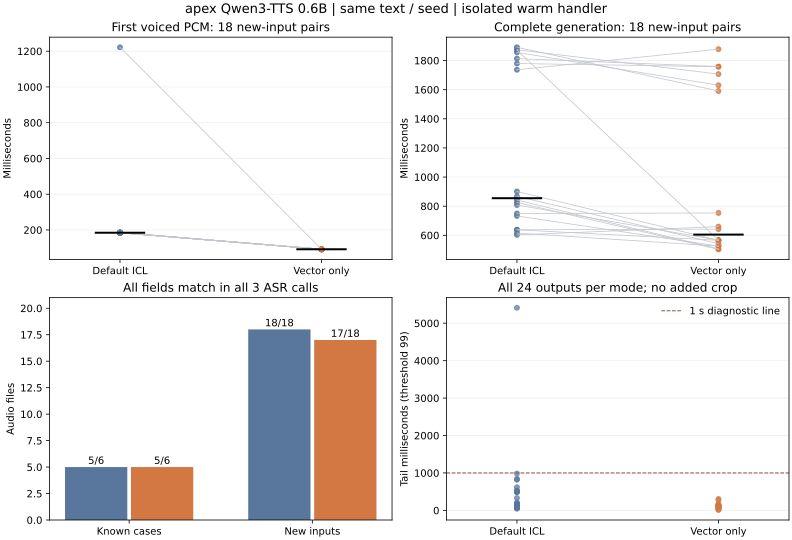

# 数字疑点与长尾复核：向量条件提速，内容疑点仍保留

2026-10-20，apex RTX 5080 16GB。按[运行前协议](PLAN.md)依次完成原PCM复核30次、既有64条音频各3次识别，以及48条默认ICL/仅说话人向量新生成与各3次识别。正式新生成另各带一次识别；366次重复复核与48次runner识别分别保存，没有把重复识别当成独立TTS样本。4次预热不计入正式48条。

**决定：仅向量值得保留为独立实验候选，尚不满足采用条件。** 它改变了可复现的生成静音路径，并在新编号输入上缩短首声和总生成；诊断内容检查各有一条少位转写，向量在新输入另有一条无法解析。音色、韵律和天然轻声没有取得人工验收，不能由识别匹配推导为无退化。生产默认ICL、全文预填、chunk4、temperature0.9、repetition1.05及裁剪关闭保持；没有部署或重启。



图中每条线对应同文本、同seed，两模式使用同一模型及参考音频。黑线为中位数；下方内容计数要求同一PCM的三次识别全部字段匹配。所有计时均为独立热模型/handler，不是完整说完到首声。

## 原始110022疑点

| 固定原音频 | 识别次数 | 观察编号 | 不同规范化转写 | 字段结果 |
|---|---:|---|---:|---|
| 明确中文读法，场景0/seed4409 | 20 | 全部10022 | 1 | 20次mismatch |
| 原始阿拉伯输入，同场景/seed | 5 | 全部110022 | 1 | 5次match |
| 明确中文读法，长尾场景2/seed4409 | 5 | 全部100200300 | 1 | 5次match |

原疑点在本轮没有观察到随机转写波动，控制样本也持续匹配。因此不能用“单次随机ASR抖动”略过它；但稳定的ASR错误仍然可能存在，重复同一识别器不构成发音真值。保留为**TTS少读或ASR持续合并重复音尚未区分**，没有靠多数票认定哪方正确。

默认同文本/seed重新生成的PCM WAV与原疑点逐字节相同（SHA256 `65be41bf…`），三次追加识别也全为10022。向量同seed匹配110022，但向量seed6619又出现10022，三次一致；不能把原seed改善写成整个编号问题已修复。

## 5.413秒尾部来自生成路径

[原音重算](data/archived-audit.json)确认197/360帧、自然EOS。PCM共8.096秒，末尾低幅度区5412.8125ms；原始模型统计尾部5396.167ms、前导7493.583ms。PCM最后3秒有3694/48000个非零采样，峰值2、RMS0.2803个PCM单位，并非WAV末尾补出的全零。

| 测量阈值，PCM绝对值 | 1 | 3 | 10 | 33 | 99 | 328 |
|---|---:|---:|---:|---:|---:|---:|
| 原PCM尾部ms | 17.688 | 5372.563 | 5374.500 | 5396.438 | 5412.813 | 5440.000 |

阈值只用于描述原音，不用于删除样本，也不代表所有低幅度都是无声。原始模型最后五步EOS概率约为0.000069、0.000419、0.0301、0.6026、0.9550，最后一步才采中EOS；没有引入强制EOS、惩罚1.15或裁剪。

同文本“编号是一零零二零零三零零。”、seed4409、只切换参考条件的结果：

| 指标 | 默认ICL | 仅向量 |
|---|---:|---:|
| 生成帧 / token上限 | 197 / 360 | 33 / 360 |
| 结束方式 | 自然EOS | 自然EOS |
| 原始模型前导ms | 7493.6 | 273.1 |
| 原始模型尾部ms | 5396.2 | 110.9 |
| PCM尾部ms，阈值99 | 5412.8 | 120.7 |
| 调用到首有声PCM ms | 1978.4 | 91.3 |
| 完整生成ms | 3825.1 | 640.2 |
| 三次识别全部字段匹配 | 是 | 是 |

默认新PCM WAV与旧长尾逐字节相同（SHA256 `8725a1b3…`），且帧数、原始/PCM统计复现。因此该异常在HTTP和浏览器之外就能产生；只是修WAV封装或排程不能消除它。改变ICL条件使这一个配对缩短，但不证明ICL的所有长尾都已解决。

旧轮没有保留原始模型raw WAV，本轮保留了raw和PCM两层音频；这里只声明**PCM字节复现、原始层统计复现**，不声称对不存在的旧raw文件做过哈希核对。[逐项复现比较](data/reproduction.json)保留此边界。

## 既有64条音频内容回归

复用[32对盲听包](../2026-10-20-xvector-listening/RESULTS.md)的全部原PCM，未重新生成、裁剪、归一化或变速。涵盖原布局测试、重复词、长句及新增自然结尾。

| 模式 | 音频 | 识别调用 | 三次字符全匹配的音频 | 转写变化 / 请求失败 |
|---|---:|---:|---:|---:|
| 默认ICL | 32 | 96 | 32 | 0 / 0 |
| 仅向量 | 32 | 96 | 32 | 0 / 0 |

32对均在本次识别筛查中通过，没有新增内容标记。它不抹掉旧轮曾出现同PCM 0/0/2编辑的记录，也不能证明每个轻声完整或音色、韵律一致。本轮没有评分原件，没有生成MOS或代填听感。

## 48条新生成对照

固定[2条诊断、6条新编号/日期时间](cases.json)，分别使用三个预写seed。只比较默认ICL与`xvec_only=True`；两边全文预填、chunk4、温度0.9、重复惩罚1.05、原参考及token预算一致。逐阶段随机交错，没有看到结果后换seed或删除失败。沿用handler原有前导处理；没有加入实验尾部裁剪。

| 分组 / 每模式音频数 | 默认ICL | 仅向量 |
|---|---:|---:|
| 诊断 / 6：三次全部字段匹配 | 5/6 | 5/6 |
| 新输入 / 18：三次全部字段匹配 | 18/18 | 17/18 |
| 诊断首有声PCM中位 | 268.7ms | 92.3ms |
| 新输入首有声PCM中位 | 184.4ms | 91.9ms |
| 新输入首有声PCM最大值 | 1221.9ms | 92.6ms |
| 新输入完整生成中位 | 854.7ms | 604.7ms |
| 诊断尾部>1秒 | 1/6 | 0/6 |
| 新输入尾部>1秒 | 0/18 | 0/18 |
| 新输入最大尾部 | 984.5ms | 307.1ms |
| 全24条自然EOS / 撞上限 / 运行错误 | 24 / 0 / 0 | 24 / 0 / 0 |

新输入的首声中位少92.5ms，完整生成中位少250.0ms。这只是6条新文本×3seed，不能估计总体错误率、稳定p95或直接外推用户完整对话。两边新输入都无>1秒尾部，不能由该组声称长尾发生率下降。

诊断6对：4对均稳定匹配、1对仅向量稳定、1对仅默认稳定。新输入18对：17对均稳定、1对仅默认稳定。所有366次重复复核均无请求失败、缺失或本轮可见的转写变化；“至少一次匹配”与“三次全匹配”在本次相等，仍保留两类统计以防后续混用。新生成runner自带的单次字符结果与重复筛查方向一致，独立保存在原记录。

### 三条具体内容标记

| 分组 / 模式 / 文本index / seed | 预期 | 三次观察 | 含义 |
|---|---|---|---|
| diagnostic / baseline / 0 / 4409 | 110022 | 10022 ×3 | 原疑点的字节级复现 |
| diagnostic / xvector / 0 / 6619 | 110022 | 10022 ×3 | 向量并未消除重复位疑点 |
| holdout / xvector / 2 / 7703 | 10102020 | unparsed ×3 | 转写把字段前“是”写成“十”；不能确定编号本体丢位 |

第三条是稳定的边界/同音识别疑点，字符检查仅1编辑，冻结的严格解析器拒绝把“十”自动丢弃。其余两个seed向量及同seed默认均匹配。没有事后放宽规则将17/18改成18/18，也没有把unparsed当成已证实TTS读错。日期、时间各6条/模式，在重复识别中均字段匹配。

## 决定与下一步

保留向量候选的理由是首声/总生成收益可测，且已知长尾有生成侧改善；继续默认ICL的理由是内容疑点未消除、克隆条件改变后的音色与韵律无验收、完整DSH收益未测。内容与轻声问题不能由快92ms抵消。

1. 只对上表三条具体疑点做定向核对，保留原音及对应默认/向量控制；以后若使用另一识别器应另冻协议，不把同识别器多数票当真值。不要求重新填写32对细微音色评分。
2. 若继续工程验证，用独立测试入口补取消、两段队列和完整DSH配对计时，实验开关默认关闭；不得修改当前生产以获取数据。完整链路从输入最后有声样本到播放器首有声排程，另列首次/热运行，不把本页92ms计时搬过去。
3. 另一条可分开的输入实验是重复编号分组/分隔或参考片段消融；冻结新输入和验收后单变量开展，不叠加1.15或裁剪。自动内容筛查继续与音色、韵律、天然轻声未验收状态并存。

本轮只完成前述自动复核和生成实验，未运行新的取消/队列/完整DSH测试。

## 可复算证据与环境

[全部数值与逐音频统计](data/summary.json) · [紧凑指标表](METRICS.md) · [48条生成原记录](data/generation-trials.jsonl) · [运行清单](data/generation-manifest.json) · [30次原音复核](data/archived-stt/repeats.jsonl) · [192次既有音频识别](data/existing-stt/repeats.jsonl) · [144次新音频识别](data/new-stt/repeats.jsonl)

[实际执行源码](executed/tools/bench_xvector_numbers.py)及同目录依赖与cases，逐文件SHA256见[源码/版本记录](data/provenance.json)。runner只给既有布局实验增加可注入seed，旧默认不变；数字核对器未放宽。重复统计与配对检查有[6项契约](../../../bridge/tests/test_recheck_metrics.py)，拒绝把多数匹配、漏请求、换WAV或不完整配对写成通过。

```bash
python scripts/report_numeric_recheck.py --folder docs/experiments/2026-10-20-numeric-recheck
python -m unittest discover -s bridge/tests -v
python scripts/check_docs.py
python scripts/sync_plugin.py --check
```

CPU复算只需公开数值，不访问apex或模型。实际TTS/STT执行脚本、GPU调度和依赖哈希绑定本轮证据；复跑推理应新建输出目录，不覆盖本次结果。

apex证据目录为`~/voice-ai/experiments/20261020-numeric-recheck/`，约16MB。工作区`samples/2026-10-20-numeric-recheck/`保存48份PCM、48份raw WAV、逐字转写与运行日志；原始数字音频仍在既有number-reading目录。公开仓库仅数值、哈希、图和源码，不含音频、参考、完整逐字转写或评分备注。

环境最近核验2026-10-20：[结束快照](data/environment-after.json)确认生产bridge `d8b527cf…`、插件`45194657…`、配置`68dcd0a7…`与开始值相同，原bridge/ComfyUI进程保留，STT/TTS/turn健康、Ollama为空。模型加载前GPU0%/10353MiB空闲，独立加载后6724MiB空闲；48条前后无新GPU进程，各STT重放结束也未检测新进程。自有模型退出后GPU0%/5456MiB占用、10353MiB空闲。Python3.12.14、Torch2.11.0+cu130、Transformers5.20.1、faster-qwen3-tts0.5.4，完整版本见记录。没有停止其他任务、改生产、提交、推送或启动子代理。最终本地检查见[data/verification.json](data/verification.json)。


## 后续定向核对与完整链路

[后续集成验证](../2026-10-20-xvector-integration/RESULTS.md)用独立Whisper核对七份原PCM，无提示、无裁剪。原默认110022与向量10102020出现识别器分歧；向量110022/6619仍两模型10022，默认6619控制亦有新分歧，不能推翻或升级本轮ASR标记为发音真值。随后完成12取消、8队列与18DSH，取消生命周期待修、完整首段无同文配对，继续不采用或部署。
