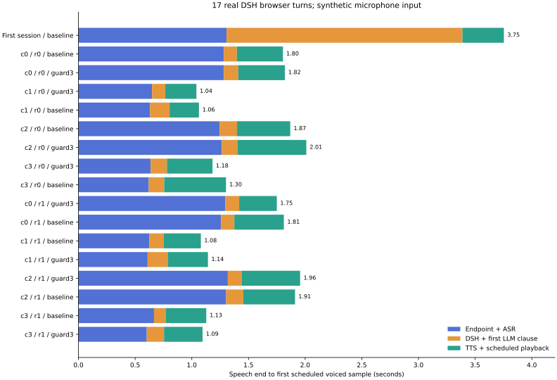

# 轻声结尾、实际播放器与完整 DSH 复测

2026-10-20，apex RTX 5080 + Mac 内置浏览器。按照[执行前协议及开发修正记录](PLAN.md)完成正式31项播放器验证、17轮真实DSH对话及36次辅助ASR。**决定：不部署幅度裁剪。** 阈值99会删掉受控轻声尾词；阈值3在本组保留尾词，但仍有更弱语音反例。它能缩短异常句尾等待，本轮没有证明首声加速。

## 轻声结尾确实会误裁

冻结6条句子，覆盖吧、好、呢、哦和结尾数字。把每条最后约1.2秒有声内容降到PCM峰值70，并补1.2秒数字静音；正文前缀不变。这里的“轻声”是受控降幅，不是天然耳语或真人录音。

| 策略 | 删除了已知尾语音的样本 | 观察 |
|---|---:|---|
| 不裁剪 | 0/6 | 原样播放 |
| 旧阈值99 | **6/6** | 删除约666–939ms的已知有声采样，不能作为保音方案 |
| 保守阈值3 | 0/6 | 本组尾语音保留，主要删除补入静音；不保证所有弱声安全 |

“已知有声”指降幅前绝对幅度至少1%的采样；上述毫秒是这些采样的累计数量，不是人工标出的连续词时长。[逐样本损失核对](data/weak_checks.json)

最直观的数字例句是“请记住，最后的数字是七二九”：原始压力样本和阈值3输出都转写出“七二九”，阈值99只剩“请记住最后的数字是”。独立放大的后缀转写在6条上，baseline与阈值3均相同；阈值99全部不同。完整音频有一处首字转写差异，不能写成全部转写逐字一致。保留前缀逐字节相同，ASR是辅助证据，不是音质评分。[36次辅助ASR](data/listening-asr.json)

更弱峰值2的尾词仍可能被阈值3裁掉，已明确保留单元测试反例。与同时归档的[严格数字零方案](../2026-10-20-tail-safety/RESULTS.md)相符：仅幅度无法保证语音安全。严格方案保留全部非零样本，却无法删除真实的非零低幅度长尾。本轮没有覆盖或替换该独立方案。

## 真实播放器验证

测试入口直接打包与apex独立插件源文件哈希一致的 `ReplySpeaker`，经真实HTTP分块输入和AudioContext播放，不另写替代播放器。完整DSH阶段则使用实际已部署的插件。正式31项包括6个弱尾×3策略、异常长尾/真正句中1.2秒停顿/800ms迟到包各3策略、连续两段2策略和取消2策略。所有正常播放都收到实际`ended`事件，取消后未再排入新source，`speaking`为false。

异常长尾来自先前seed25原录音。最终正式运行：

| 场景 | baseline播完 | 阈值3播完 | 收益范围 |
|---|---:|---:|---|
| 单段异常尾部 | 约7.20 s | 约2.27 s | 少等待约4.93 s |
| 异常段接下一句 | 9.428 s | 4.497 s | 实际浏览器队列少等待约4.93 s |

起点是播放器测试发起HTTP请求，终点是本次试验最后一个AudioBufferSource的`ended`回调。它证明AudioContext实际推进并完成播放，不含耳机/扬声器回录。事件循环、首次AudioContext建立和网络均可能影响该间隔，不能把它当作模型生成耗时。

27项有单一流ID的播放器测试，加17轮真实DSH，合计44项核对：浏览器排定总采样数均等于HTTP实际输出采样数。受保护输出均为原始PCM前缀；真正句中停顿位于有声范围中点，没有被段尾规则删除。迟到包仍会引起播放欠载，保护器没有修复网络问题。[采样数核对](data/frame-checks.json) · [正式播放器事件](data/browser-player.json) · [代理逐包记录](data/proxy-streams.jsonl)

开发阶段另有31项运行，因测试fetch包装器遗漏URL对象、以及停顿夹具一度插入原音频静音尾部，修正后全量重跑。保留[开发结果](data/browser-player-initial.json)与[旧夹具清单](data/fixtures-initial.json)，不与正式结果混合。未把工具问题归因生产插件。

阈值3在之前77条归档录音/137段的额外重放中，有4段删除约4.20–5.01秒；有原始包时序的36轮未新增估算欠载或推迟首声。这是补充重放，不能当作新增真实浏览器样本。[重放记录](data/replay3/replay.json)

## 完整“说完到首声”

真实路径：合成输入 → 生产AudioWorklet/MicRecorder → apex断轮/STT → 实际DSH会话 → Qwen3.5 9B → Qwen3-TTS 0.6B → 生产ReplySpeaker。没有直接调用Ollama代替DSH。输入600ms句中停顿的四轮均只形成一条完整用户发言，页面最终共17轮。

首次请求单列，另4类输入×2策略×2次共16轮热运行。各策略均经过同一个诊断代理、PCM落盘及计时钩子。未控制两轮生成的回复相同，会话历史和GPU时序也有影响，不能把组间毫秒差异全部归因于裁剪。

| 等待路径 | baseline | 阈值3候选 | 每策略样本数 |
|---|---:|---:|---:|
| 0.5秒判完快速路径，中位数 | **1.104 s** | **1.119 s** | 4 |
| 1.2秒兜底路径，中位数 | **1.840 s** | **1.889 s** | 4 |
| 新会话首次请求 | **3.753 s** | 未设首轮对照 | 1次单列 |

热运行全部16轮范围 **1.041–2.010秒**，无接口失败或超时。快速路径的断轮/STT文字可用约602–666ms；兜底约1245–1318ms。文字可用后，DSH到首段TTS请求约105–178ms，TTS到首有声排定约259–608ms。首轮DSH/LLM阶段另为约2.082秒。



混合两种路径后的中位数为baseline1.553秒、候选1.466秒，但分路径中位数并未变快。联合中位数位于两个等待簇之间，本轮不以这个混合数字宣称首声提升。小样本不报告稳定p95。[逐次与分组表](METRICS.md) · [原始17轮事件](data/browser-e2e.json)

起点是输入最后一个绝对幅度≥0.01的采样播放时刻；终点是输出第一个同阈值有声采样在AudioContext上的排定时刻。首声仍是排定时刻，不是硬件实声回录。首次请求前9B未驻留，但未控制OS/磁盘等缓存，不能称严格冷启动。输入由合成流替代真实麦克风，未验收真人自然停顿、外放回声或真人VAD插话。

实际DSH页面与完整计时 — local-only artifact: `e2e-browser.png`

## 回听交付和未完成项

已生成18个对照单元的自包含回听页，真实浏览器播放控件已验证；每条都有原始、阈值99、阈值3三版放大后缀。其中阈值99有一条尾部全部被裁掉，明确标为无音频可播，其余17段可回放。放大仅便于比较尾词，不用于自然响度或音质评分。HTML及三条数字样音位于工作区 `samples/2026-10-20-player-validation/`，音频不进入公开仓库。

**人工听检仍为pending。** 当前会话不支持接收音频输入，不能声称已经亲耳听过；浏览器播放成功、波形和ASR检查均不能代替主观判断。评分表默认“未听”，可导出本地JSON，没有代填结果。[人工状态](data/human-review.json)

回听页及未评分状态 — local-only artifact: `listening-review.png`

下一步先取得自然轻声与人工评分，再判断裁剪的保留范围；模型生成端EOS/长度上限问题按独立生成实验处理。生产继续保持不裁剪，不把阈值3或严格数字零方案自动上线。

## 复现、维护及恢复

脚本：`prepare_player_validation.py`准备夹具，`player_validation_proxy.py`仅监听apex loopback8766，保留DSH认证与WebSocket，`player_validation_client.js`注入测试UI并导入原ReplySpeaker，`review_player_audio.py`制作对照页，`report_player_validation.py`重算本页表格和图。

```bash
node ../dsh-voice-ai-girlfriend-plugin/node_modules/esbuild/bin/esbuild \
  scripts/player_validation_client.js --bundle --format=iife \
  --tsconfig=../dsh-voice-ai-girlfriend-plugin/tsconfig.json \
  --outfile=/tmp/voice-player-validation-client.js
python scripts/report_player_validation.py --folder docs/experiments/2026-10-20-player-validation
python -m unittest discover -s bridge/tests -p test_stream_tail.py -v
```

生产bridge及插件哈希未变；未升级包、覆盖配置、重启生产或新增GPU模型副本。测试后关闭麦克风，卸载本轮由DSH加载的9B，清理自有代理及端口转发。bridge和ComfyUI原进程保留，STT/TTS/turn健康。[结束环境检查](data/postcheck.json)

保护器当前18项契约在本地及apex Python3.12均通过，整个工作区Python测试46项通过（包括同步到工作区的其他实验测试）。lint、格式、源镜像与diff检查通过；33份已存在维护文档无坏链接。结束时整库checker另登记了一条同期进行中实验尚未生成的`repetition-validation/RESULTS.md`，整体链接检查记为pending，未删除或代写其占位。[验证记录](data/validation.json) · apex测试输出 — local-only artifact: `data/apex-guard-tests.log` · [代码清单](data/manifest.json)

没有提交或推送。本轮是旧生产构建的真实链路验证，不替代维护候选M0部署回归。
