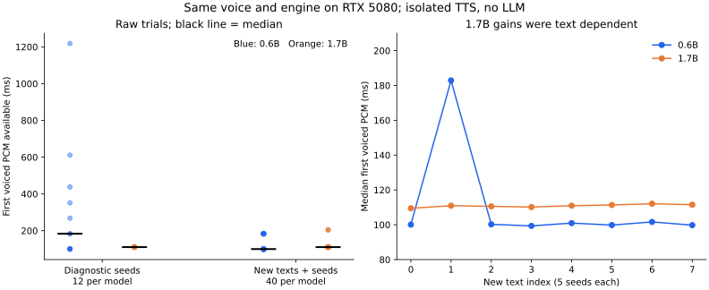

# 流式段尾保护与 0.6B / 1.7B 模型对照

2026-10-20，在 apex RTX 5080 上完成。按[预写协议及追加阶段](PLAN.md)执行，同参考音频、同推理库，生产服务保持原样。

**决定：保留生产 0.6B；段尾保护 v2 保留为独立实验原型。** 1.7B 改善了部分已知慢句，但在新文本上没有整体首声收益，增加约 2 GiB 显存。保护器能缩短异常段尾，仍有轻声误裁风险，不能默认启用。

## 换模型的实际结果

先对四条旧文本、诊断 seed 0/16/25 各测 12 条。由于其中包含 0.6B 的已知慢 seed，另冻结八条新文本和五个新 seed，各做 40 条，合计 104 条生成。两组分别报告，不能混合推断总体慢样本概率。

| 新文本组（每模型 40 条） | 0.6B Base | 1.7B Base |
|---|---:|---:|
| 首有声 PCM 可用中位数 | 100.2 ms | 110.9 ms |
| 本组最大值 | 184.9 ms | 205.3 ms |
| 生成时间 / 输出音频时长中位数，越低越快 | 0.274 | 0.304 |
| 独立进程加载增量显存 | 3629 MiB | 5653 MiB |
| 原音频 ASR 去标点精确匹配 | 39/40 | 39/40 |

以上计时从调用 handler 开始，到首个含 1% 以上幅度样本的 PCM 块可用；不是用户说完到听到声音。两模型没有与 9B 同时生成，未测试替换默认后完整栈的显存或端到端速度。加载增量为整卡快照之差，包含 CUDA 图等进程开销，不只是权重大小。



1.7B 在旧诊断组的首声中位数为 110.9 ms，0.6B 为 183.5 ms；0.6B 重新出现 seed16 的 1218 ms 等待及 seed25 的约五秒低幅度尾巴，1.7B 在这 12 条没有出现。新文本组里，两模型各 40 条均未出现大于 1 秒的段尾低幅度区；这不证明它们以后没有长尾。

收益依赖文本。新文本编号 1 的中位数从 182.9 ms 降至 110.9 ms，另七条的 0.6B 中位数约 99–102 ms，1.7B 约 109–112 ms。因此暂不以“更大”为理由换默认模型。两次模型加载按顺序执行，未随机交替加载，结果是这次受控探测，不是严格跨运行稳定性结论。

原音频全部 104 条做了现有 FunASR 检查，102 条去标点精确匹配。两处差异分别为“在/再”和“试一次/十一次”，均有同音解释；没有人工回听，不能据此归因为 TTS 错读，也不能声称音质无差别。新生成音频唯一触发裁剪的 0.6B seed25 在裁剪后也匹配预期，总计 105 次检查、103 次精确匹配。

逐次数据、参考音频哈希、模型参数与资源见 [METRICS](METRICS.md)、[初始 0.6B](data/0.6b/manifest.json)、[初始 1.7B](data/1.7b/manifest.json)、[新文本 0.6B](data/holdout-0.6b/trials.jsonl)、[新文本 1.7B](data/holdout-1.7b/trials.jsonl)。参考音频哈希两模型一致，音频及参考文字未进入公开仓库。

## 段尾保护：从离线到流包装器

实现位于 `bridge/stream_tail.py`，**没有被生产 bridge 导入或启用**。输入为 16 kHz PCM16，幅度阈值 99；仅正常段结束时处理长于 1 秒的末尾低幅度区，保留 300 ms。句中恢复有声时原样释放缓存。暂存最多 256000 字节，超限放行当前低幅度区；取消或异常丢弃暂存并关闭自有上游迭代器。上限只指暂存 PCM，输入块、输出副本和 Python 对象另占内存。

v1 暂存整个低幅度区，旧包时序重放出现最大 11.067 ms 新欠载和 1.25 ms 首声后移。v2 改为立即放行前 300 ms，仅暂存后面的部分；保留的 PCM 样本规则不变。

| 冻结旧数据重放 | v1 | v2 |
|---|---:|---:|
| 录音 / 分段 | 77 / 137 | 77 / 137 |
| 具有原 PCM 包到达时间的完整回答 | 36 | 36 |
| 首声最大新增等待，包时序估算 | 1.25 ms | 0 ms |
| 累计欠载最大新增量，包时序估算 | 11.067 ms | 0 ms |
| 实际暂存峰值 | 177996 字节 | 168396 字节 |

77 条包括前轮首句实验 36 条完整回答和隔离追踪 40 seed 加一次重放。后 41 条没有处理器 PCM 逐包时序，只核对字节，不补造到达时间。各段输出均与前轮离线规则逐样本一致。

旧数据中四条受影响录音分别删除 5262 / 5094 / 5075 / 5056 ms 低幅度音频；有时序的前三条理想播完时间相应提前约五秒。新的 104 条模型输出也用 v2 重放，未出现首声后移或新增估算欠载。旧数据与新 seed25 是重复条件，不能把五条观测当作五个独立问题类型。

[v1 数值与代码哈希](data/replay-v1/replay.json) · [v1 实现快照](data/stream_tail_v1.py) · [v2 数值与代码哈希](data/replay-v2-final/replay.json) · [新模型输出 v2 重放示例](data/0.6b/guard_v2.json)

原始v2的[实现快照](data/stream_tail_v2.py)已保存，后续参数与流适配接口修改不覆盖该轮实现；最新实际播放器及轻声验证见[后续实验](../2026-10-20-player-validation/RESULTS.md)。

## 为什么还不能上线

- 14 项保护器契约已覆盖短尾、超长尾、长句中停顿、全低幅度、溢出放行、跨块、空输入、极值、取消和异常。另有一个明确的弱尾词反例：低于幅度阈值且持续足够久的真实尾词也会被裁。该测试记录已知限制，不是安全性通过。
- 字节保留能证明未改写保留的前缀，ASR 相同只能辅助检查文字，不能证明尾音自然、没有咔哒或轻声漏字。真实慢速生成、网络停顿也可能使长句中缓存引入等待；本组重放通过不覆盖这些情况。
- 本轮没有接入 HTTP 流式接口或浏览器播放器，没有真人麦克风或主观音质评测，不能把裁剪五秒写成生产延迟下降五秒。

下一步以受控回听、轻声负例和实际浏览器候选链路为主。若弱声误裁不能被可靠约束，就继续关闭幅度裁剪；不靠提高阈值追求更大的删除量。更换模型的后续价值主要在语音质量或特定失败句，需要单独盲听及 9B 共存验证。

## 复现与运行状态

工具：`scripts/bench_tts_models.py`、`scripts/replay_stream_tail.py`、`scripts/evaluate_model_audio.py`；CPU 图表和表格由以下命令重算：

```bash
python scripts/report_stream_guard.py --folder docs/experiments/2026-10-20-stream-guard
python -m unittest discover -s bridge/tests -p test_stream_tail.py -v
```

模型/音频实际实验使用主机目录 `~/voice-ai/experiments/20261020-stream-guard/`，未把生产配置或安装包替换为候选。初始实验脚本的固定哈希版本保存在 [初始脚本快照](data/bench_tts_models_initial.py)，追加阶段使用当前 `bench_tts_models.py`。所有模型实验使用 v1 guard 记录，随后独立用最终 v2 重新做时序重放；因此未把两版处理器的开销混为同一测量。

1.7B 官方快照约 4.54 GB，保留在 apex 的项目模型缓存供后续实验；没有设为默认。两个临时模型进程都已退出，9B 保持实验前未加载状态。生产 STT/TTS/turn 健康、bridge 和插件哈希未变、ComfyUI 原进程仍在。未带 token 的 DSH 请求返回 401，只核验服务与认证边界，没有绕过认证或记作 UI 回归。[环境及结束检查](data/postcheck.json)

本轮本地 Python 合约总计 25 项，含上述 14 项；apex Python 3.12 也通过这 14 项保护器合约。脚本及新模块 lint/格式检查、25 份维护文档本地链接、根目录进度/历史链接、源码镜像及 diff 检查通过。原始清单中的脚本/保护器哈希与归档实现一致。没有修改生产功能或默认配置，没有提交或推送。整理候选的 M0 部署回归、真人输入验证和原生双工方向保持独立。
