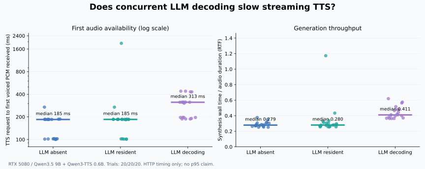

# TTS 同卡争用实验结果与使用价值决定

2026-10-20，apex / RTX 5080 16GB。先完成 12 次预实验检查流程，再完成正式 60 次测量，三组各 20 次。协议先于正式测量写入 [PLAN.md](PLAN.md)。

## 判断

项目有继续做个人语音助手的使用基础，值得投入有限诊断和真人可靠性验证。当前不足以声称已适合稳定日常使用，也不需要立刻扩大到新模型训练或复杂调度。本轮实验的价值在于用较低成本排除了“只要 9B 驻留就普遍拖慢 TTS”的简单解释，并量化了正在生成时的影响。

**决定：保留现有部署，继续针对短首句与偶发长尾做小实验；不在本轮改生产调度。** 真人麦克风、外放回声及自然犹豫仍是决定最终使用价值的下一项必要证据。

## 正式结果

起点是向 loopback bridge 发出 TTS 请求，终点是测试客户端收到第一个包含有声 PCM 的网络块。它不是浏览器播放时刻，不包含 ASR、DSH、LLM 生成第一句、远程网络或声音硬件延迟。

| LLM 条件 | 样本 | 首有声音频中位数 | 最慢一次 | 合成 RTF 中位数 |
|---|---:|---:|---:|---:|
| 未加载 | 20 | 184.7 ms | 269.7 ms | 0.279 |
| 已加载、无本实验生成请求 | 20 | 185.2 ms | **1906.1 ms** | 0.281 |
| 正在生成 | 20 | **313.1 ms** | 439.5 ms | 0.411 |

RTF 是完整合成墙钟时间除以生成音频时长，越小越快；它不是首声时间。60 次均返回有效有声音频，无 HTTP 错误。20 次并发均验证：LLM 首个非空输出早于 TTS 请求，并有后续输出跨过首有声音频到达时刻。



左图使用对数刻度，保留 1.9 秒长尾；横线为中位数。[逐次数据](data/trials.jsonl) · [完整统计](METRICS.md) · [机器可读汇总](summary.json)

### 文本差异

| 文本 | 仅驻留中位数 | 并发中位数 | 差值 |
|---|---:|---:|---:|
| 好呀，我们开始吧。 | 185.2 ms | 430.7 ms | +245.5 ms |
| 你是想吃火锅还是螺蛳粉呢？ | 101.8 ms | 313.1 ms | +211.2 ms |
| 这个问题我想了一下，我们可以先从最简单的方法开始。 | 185.3 ms | 313.2 ms | +127.9 ms |
| 长解释句，全文见 manifest | 185.8 ms | 196.5 ms | +10.7 ms |

四个文本方向一致，其中三个超过协议预先设置的 100ms 工程筛选阈值。总体中位数差约 128ms；这是本轮分布的观察，不是对所有对话的预期收益。较短首句在这套输入上受到更明显影响，值得单独设计后续实验。

## 假设检验与限制

1. **生成争用得到支持。** 仅驻留与未加载的中位数接近，并发组更慢，RTF 也从约 0.28 增至 0.41。该实验没有测 GPU 内部调度，不能据此精确分解算力、带宽或 kernel 串行的贡献。
2. **仅模型驻留普遍拖慢的证据不足。** 中位数仅差约 0.5ms。但驻留组有一个明显长尾，不能将“中位数接近”写成所有请求都无影响。
3. **1.9 秒长尾尚未定位。** 正式第 38 次在无本实验生成请求的组出现，首字节与首有声块均为 1906.1ms。它出现在两个驻留组请求之后，但本轮未持续记录服务器内部排队、生成静音或取消后尾任务，无法确定原因。不能把它直接归为 TTS 句首静音，也不能说同卡并发解释了全部长尾。

TTS 服务没有按请求固定采样种子，重复生成的音频时长不同。每文本每组只有五次，尚无跨说话者、不同音色或多会话验证。未加载组在前后分段，中位数分别约 144ms（8次）与 185ms（12次），显示一定随机/时间波动；没有据此删除任何请求。并发与仅驻留组在同一加载状态下交错排序，作为主要比较。

本轮不报告稳定 p95，不拿本地 HTTP 结果替换 README 的四轮完整 DSH 延迟，也不声称已改善实际产品速度。

## 输出有效性抽查

按运行顺序每组每文本取首段，再加第 38 次长尾，共 13 段，用当前 FunASR 转写；没有按速度挑样本。去除标点后 13/13 与输入一致，见 [抽查记录](data/asr_spotcheck.json)。这是文字完整性的自动抽查，不证明全部 60 段音色、韵律或主观质量合格；没有真人麦克风测试。

## 复现与环境

实验主机保留生产插件 `45194657…`；测试客户端直接请求当前 bridge，没有经过插件，也没有部署本地维护候选。TTS 为 Qwen3-TTS 0.6B、音色 xiaoya-qwen3、streaming_chunk_size=4。LLM 是本地 text-only Qwen3.5 9B Q4_K_M，32K 上下文、关闭思考；模型完整驻留 GPU。确切 digest、服务版本、TTS 设置及源码哈希见 [manifest](data/manifest.json) 和 [环境快照](data/environment.json)。

在有相同模型和服务、且本项目 LLM 最初未加载的实验主机运行：

```bash
python scripts/bench_tts_contention.py --out /path/to/new-experiment --repeats 5
```

脚本拒绝覆盖已有实验，检查初始模型与 GPU 状态，临时加载/卸载本实验模型，保存生成音频和逐次 JSONL。并发任务只关闭自身请求，不重启 Ollama。原始音频位于 apex `~/voice-ai/experiments/20261020-tts-contention/main-01/audio/`，未复制进公开仓库。

仅重算统计和图片，无需 GPU：

```bash
python -m pip install -r requirements-dev.txt
python scripts/report_tts_contention.py \
  --data docs/experiments/2026-10-20-tts-contention/data \
  --out docs/experiments/2026-10-20-tts-contention
```

[预实验数据](pilot/trials.jsonl) 单独保存，不并入正式 60 次。[实验后检查](data/postcheck.json) 确认 bridge 的 STT/TTS/turn 均健康，LLM 恢复最初的未加载状态，生产 bundle 和 bridge 内容哈希未变。DSH/bridge 未重启，其他服务未停止；未提交或推送。

## 下一项值得做什么

**优先真人耳机测试，再做首句策略对照。** 本轮已能说明并发有实用量级影响，继续无限堆同类样本的收益较低。

首句策略实验应冻结同一完整回答，比较不同首段长度/切分点，保留有信息的回答内容，不能靠提前播放“好呀”或提示音刷快首声。记录首有声音频、有效答案开始、句间间隔和人工听感；先在固定文本上筛选，再接回真实 DSH。仅当完整链路有收益且没有漏字/语调退化时，才考虑修改默认值。

长尾另做隔离追踪：在完全没有 LLM 生成的独立一组中重复同一句，并补充 bridge 排队、模型首块与有声输出的分段时间。当前一次样本足以说明不能忽略长尾，尚不足以选择修复方法。
