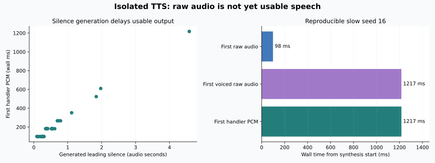
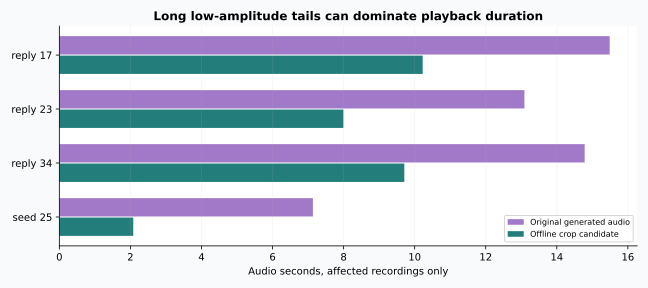

# TTS 长尾内部追踪与尾部保护实验

2026-10-20，在独立进程加载同一Qwen3-TTS 0.6B和小雅参考音色；生产bridge保持运行、LLM未加载。按[预写协议](PLAN.md)执行seed 0–39，再重放唯一超过1秒的seed16，共40次正式样本和1次复现。

**结论：已复现并定位一种长尾机制，尚未修复生产。** 模型可以很早产出音频，却先生成数秒静音；处理器要等到有声段才给出可播放PCM。另发现有声段结束后也可能生成很长的低幅度尾巴，离线裁剪值得继续验证。

## 模型首块与可用首块

| 指标 | 40个正式seed |
|---|---:|
| 模型原始首块中位数 | 98.5 ms |
| 处理器首块PCM中位数 | 182.0 ms |
| 最慢处理器首块 | 1216.9 ms |
| 处理器首块超过1秒 | 1 / 40 |

这组seed是诊断用固定集合，不代表生产随机分布或用户遇到长尾的概率。[全部数值](METRICS.md) · [原始事件](data/trials.jsonl) · [模型与GPU清单](data/manifest.json)



seed16的原始第一个块在98.5ms到达。前14个块各约0.32秒音频，峰值低于0.0001，均没有达到1%有声阈值；第15块才包含语音。原始前导静音共4583.875ms音频，首个原始块之后又等待了约1.12秒墙钟时间才取得有声段。

| seed16 | 正式 | 重放 |
|---|---:|---:|
| 原始首块 | 98.5 ms | 98.6 ms |
| 原始首个有声块 | 1216.7 ms | 1219.3 ms |
| 处理器首块PCM | 1216.9 ms | 1219.5 ms |
| 原始前导静音 | 4583.875 ms | 4583.875 ms |

处理器保留40ms开头余量并裁剪前导静音，原始有声块到处理器首块只差约0.2ms。因此这个样本的主要等待发生在模型继续生成静音，而不是处理器裁剪运算太慢。提高裁剪阈值或单纯删除已经生成的静音，并不能收回模型已经花掉的计算时间。

本轮没有HTTP队列，没有LLM请求，排除了这些因素对该隔离样本的必要性。上轮1906ms和首句实验1854ms没有同样的内部轨迹，仍不能直接判定与seed16完全同因。

## 另一种长尾：有声段之后

seed25在610ms左右给出首块，最终PCM长7.136秒。末尾约5.415秒低于1%幅度，自动转写却仍是“好呀我们开始吧”。单看转写和首声会漏掉这段额外播放等待。

按1%阈值的低幅度分析见[data/pause_analysis.json](data/pause_analysis.json)。阈值分析不等于人工静音标注，不能盲目删掉所有低幅度音频；软尾音和真实句中停顿需要保留。

## 离线尾部保护候选

观察到长尾后，先补写协议再处理既有音频，不生成更多TTS。采用更低的0.003幅度阈值，只处理大于1秒的段尾，保留300ms余量；句中区间不处理。

| 受影响记录 | 裁剪前生成音频 | 裁剪后 | 删除低幅度音频 |
|---|---:|---:|---:|
| 首句实验第17轮 | 15.488 s | 10.226 s | 5.262 s |
| 首句实验第23轮 | 13.088 s | 7.994 s | 5.094 s |
| 首句实验第34轮 | 14.784 s | 9.709 s | 5.075 s |
| 隔离seed25 | 7.136 s | 2.081 s | 5.056 s |



前三段来自[首句对照](../2026-10-20-first-clause/RESULTS.md)，全部36轮中只有这三轮触发候选规则；隔离40seed中只有seed25触发。两类集合条件不同，不混合给总体发生率。

四段裁剪后自动识别内容与原文去标点后均一致，保留的PCM前缀未改。[本组裁剪数值](data/crop_results.json) · [本组裁剪后转写](data/crop_asr_check.json) · [本组原转写](data/asr_check.json)

这是离线候选，不是已上线的优化：TTS生成耗时不变；原始块重放估算表明部分录音可少排队播放约5秒，但真实流式播放器尚未测试。低幅度软声尾词仍可能被阈值误判，必须回听并加入负例，不能把ASR相同写成听感无损。

## 复现与资源

`scripts/trace_tts_tail.py --repo /path/to/main-repo --out /path/to/new-run --runs 40` 在独立进程中使用生产模块的加载函数。只包装该进程自己的模型方法，没有改安装包或运行bridge；离线缓存加载，额外模型加载约3.18秒，加载后仍有6726MiB空闲显存。进程退出后释放自己的模型。

阶段图、统计和尾部对照图可用CPU重算：

```bash
python scripts/report_tts_followups.py \
  --tail docs/experiments/2026-10-20-tts-tail/data \
  --clause docs/experiments/2026-10-20-first-clause/data
```

音频低幅度分析脚本为 `scripts/analyze_generated_pauses.py`；离线裁剪脚本为 `scripts/probe_tts_tail_crop.py`，均读取主机实验目录里的既有WAV。原音频、裁剪音频留在apex，不进入公开仓库。

生产bridge PID仍为3504737，内容哈希及插件哈希未变；STT/TTS/turn健康，9B恢复未加载，其他GPU进程仍在。[实验结束检查](../2026-10-20-first-clause/data/postcheck.json)

## 接下来的实现顺序

保留当前切句，优先做可撤回的流式段尾保护原型：只在确认段结束后裁剪，限制缓存占用，并测试轻声尾音、噪声、句中长停顿与取消。客户端已经排定的音频如何撤回、或者服务端如何暂存静音，需要按现有取消契约设计。

前导静音另做生成参数对照。固定某个“好seed”只对这句话有效，不能当作通用修复。先覆盖多种有效首句和音色，再决定是否改变采样或模型。此次实验没有更改默认参数、没有部署或提交代码。
