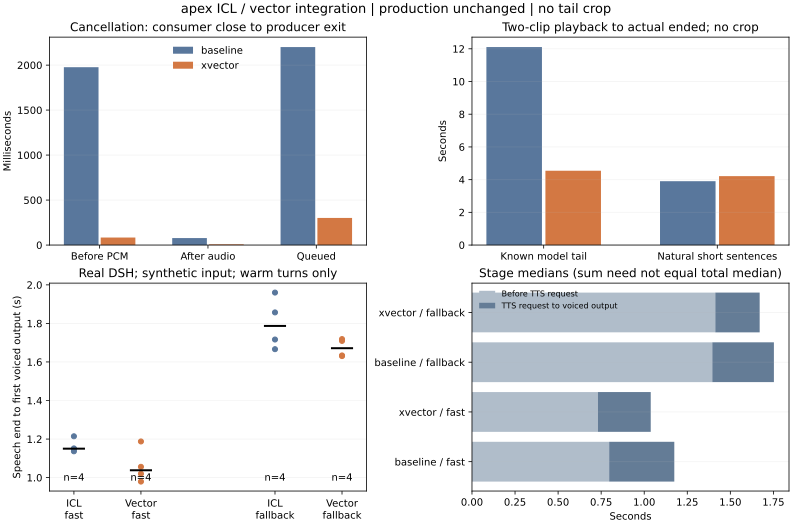

# 默认ICL与仅向量：定向识别及集成验证

2026-10-20，apex RTX5080 16GB。按[冻结协议及开发修正](PLAN.md)执行，生产配置、bridge、插件与裁剪关闭保持。固定重复惩罚1.05、温度0.9、全文预填、chunk4与原小雅参考，仅比较ICL条件与xvec_only。新权重只有CPU独立识别器，未安装或更改生产依赖。

**决定：向量条件仍保留为隔离候选，生产继续默认ICL。** 固定长尾队列有明显改善；完整链路的两个路径各观察到约0.11秒中位差，但首段文本没有一对相同，尚不能认定稳定因果收益。持续数字疑点及取消生命周期问题未解决，音色、韵律、天然轻声未验收。优先修公共取消路径，再决定是否投入向量模式。



每个取消/队列单元2次，每个热链路路径/模式4次；模型静音造成的间隔与播放器排程间隔分别计。下方阶段中位数的和不必等于整体中位数。

## 三条疑点与配对控制

使用[Whisper-small官方多语言模型](https://huggingface.co/openai/whisper-small)，固定实际revision、CPU FP32，greedy和beam5各一次，无预期数字或纠错提示。七份原PCM的哈希与上轮一致，没有重新生成或裁剪来替换疑点。两个解码共享一个模型，不当两个独立识别器；与[上一轮FunASR重复识别](../2026-10-20-numeric-recheck/RESULTS.md)比较。

| 固定原音频 | FunASR原记录 | Whisper greedy / beam5 | 本轮判断 |
|---|---|---|---|
| 默认110022 / 4409，原疑点 | 10022 | 110022 / 110022 | 识别器分歧，不能确认为TTS少读 |
| 向量110022 / 4409，配对控制 | 110022 | 110022 / 110022 | 本次自动检查一致匹配 |
| 默认110022 / 6619，配对控制 | 110022 | 11002 / 11002 | 新发现识别器分歧，原控制也不能当真值 |
| 向量110022 / 6619，原疑点 | 10022 | 10022 / 10022 | 两识别器一致的持续少位标记，优先级最高，仍非听检定论 |
| 默认10102020 / 7703，配对控制 | 10102020 | 10102020 / 10102020 | 本次自动检查一致匹配 |
| 向量10102020 / 7703，原疑点 | “是→十”边界unparsed | 10102020 / 10102020 | 独立识别可读全序列，不能按旧unparsed断定吞位 |
| 原阿拉伯输入110022 / 4409 | 110022 | 110022 / 110022 | 额外原输入控制匹配 |

Whisper部分输出繁体字段标签，严格原判定仍保留；上表数字来自预写的标签字面简体映射后核对，不删除“十”、补位或放宽数字规则。原始14项严格/映射两列见[识别记录](data/whisper/checks.jsonl)，七份配对见[合并摘要](data/targeted-summary.json)。5/7音频在Whisper两解码均匹配，2/7未匹配；这不是人工准确率或独立抽样错误率。音色、韵律、天然轻声继续未验收，没有构造用户评分。

## 实验入口与共同资源条件

独立loopback代理只把测试标签的TTS指向自有模型，普通页面仍用生产8765；DSH HTTP/WebSocket保留认证。实验进程导入实际部署版voice_bridge.py，直接调用原tts_stream与_synthesize_iter，保留原取消监视、串行锁和线程退出逻辑，仅加计时和原PCM保存。播放器导入真实ReplySpeaker，完整链路使用部署插件，未另写替代播放器或伪造LLM回复。

生产TTS仍驻留，所以比正常生产多一份实验TTS。新模型预热后仅清理自有闲置缓存，随后正常加载本项目Qwen3.5 9B/32K；API size_vram=size=6315069931，原GPU条件保持。完整阶段为防多句回复留下闲置缓存挤占余量，在自有模型释放锁前再empty_cache，两模式相同、清理与锁等待有记录。不会释放生产分配器，不降低上下文、GPU层数、量化或token预算，也没有增加裁剪。

该共同资源条件与仅一份TTS的生产环境不同，绝对延迟不能直接替换既有生产数字。首次两模式都已预加载模型，约1.45秒的9B加载请求单列，不算入其新会话首声，不叫严格冷启动。正式完整链路39条TTS流的自有闲置缓存清理中位1.73ms、最大2.68ms；这些释放锁前的耗时被保留，后继请求的等待没有扣掉。它也不能解释成向量模式本身的收益。

## 12项取消

每模式两次首PCM前、首个source后250ms、排队请求取消。浏览器调用真实ReplySpeaker.stop及AbortController；不是真人开口或Silero触发的插话测试。全部取消段未观察到停止后新增source，后续短请求能继续。

| 从HTTP消费者关闭到生成线程退出，中位ms；各2次 | 默认ICL | 仅向量 |
|---|---:|---:|
| 已知长前导、首PCM前取消 | 1976.7 | 83.5 |
| 首source后取消 | 77.6 | 7.7 |
| 排队取消 | 2200.9 | 301.2 |

数值不是浏览器stop到硬件静音。首PCM前原本就没有播放，不提供负数或虚构停播时长；其他实际onended与stop时间保留。源已停止不代表服务器生成已退出。

复用原取消逻辑，发现已取消的排队请求仍会在拿到锁后进入handler，直到首个可返回块才检查cancel。已知默认长前导在此期间继续持锁约1.98秒，向量同文本约0.09秒；第三条真实短请求因此出现额外等待。向量缩短了这个特定浪费，但**两种模式都未修复取消请求仍开算的生命周期问题**。本轮不为获得好结果改生产或同时修公共取消路径；下一项应独立验证“取消后不再开算”和更细生成侧取消边界。

## 8项连续队列

真实播放器连续读取两段TTS，等实际ended；两组文本×两seed×两模式。已知长尾编号100200300/4409后接自然短句，另一组为两条普通短句。没有删尾、调响或变速。分段按两份HTTP PCM精确采样边界还原，不依赖可变化的全局segment标签。

| 调用到两段实际播完，中位；各2次 | 默认ICL | 仅向量 |
|---|---:|---:|
| 已知模型长尾组 | 12.109秒 | 4.545秒 |
| 普通短句组 | 3.902秒 | 4.215秒 |

长尾组第一段末有声到第二段首有声约5.53秒 / 0.23秒；纯播放器分段排程间隙两模式均约50–56ms。因此主要差异在模型生成的低幅度音频，不是播放器普遍多卡了5秒。普通短句向量的总播完更长，包含音频长度/说话节奏差异，不把所有更短或更长当成质量好坏。八项收到和排定采样数全部一致，不能由此认定音色和轻声通过。长尾组四份PCM与上一轮同模式/seed逐字节相同，见[哈希核对](data/known-tail-reproduction.json)，没有通过新增裁剪取得改善。

## 完整DSH说完到首声

| 说完到首有声排程 | 默认ICL | 仅向量 | 每模式样本 |
|---|---:|---:|---:|
| 新会话首次，模型已加载 | 3.598秒 | 1.880秒 | 1 |
| 热运行快速路径中位 | 1.150秒 | 1.038秒 | 4 |
| 热运行兜底路径中位 | 1.787秒 | 1.672秒 | 4 |
| 热运行两路径混合中位 | 1.440秒 | 1.409秒 | 8 |

正式18轮均无请求或播放失败，18/18的HTTP收到样本与AudioContext排定样本相同。失败预检另存，不混入这个分母。热运行范围默认1.136–1.960秒、向量0.979–1.719秒；未做物理声卡捕获。

| 热运行阶段中位，ms | 默认ICL | 仅向量 |
|---|---:|---:|
| 快速：说完→首TTS请求 | 796.5 | 731.0 |
| 快速：首TTS请求→首声 | 378.2 | 306.8 |
| 兜底：说完→首TTS请求 | 1395.2 | 1412.6 |
| 兜底：首TTS请求→首声 | 357.8 | 257.6 |

8个同输入配对的首TTS文本哈希全部不同，相同首段配对为0/8。快速路径前半段本身就相差约65ms，兜底前半段方向相反；不能把整段差异都归给xvec_only。两模式混合中位数只差31.3ms，更不能用首次3.598→1.880秒宣称稳定加速1.7秒。模型预加载、前导静音、首段内容、历史缓存都需保留边界。

输入为同一套冻结合成夹具，走实际AudioWorklet、0.5秒文本判完/1.2秒兜底、生产STT、DSH/9B、切句、实验TTS和真实ReplySpeaker。起点是输入最后绝对幅度≥0.01采样在输入AudioContext的时刻；终点是回复首个同阈值采样在输出AudioContext排定的时刻。不包括系统混音器、耳机或扬声器硬件，不是自然麦克风/外放回声验证。

首次每模式各一条、新页面/新会话单列；16热轮在同一会话交错平衡，各输入/模式两次。回复采样与历史仍会改变首段，不能把全部时差归给TTS参考条件。分别报告说完→首TTS请求、首TTS请求→首声；相同首段的配对另列。不提供小样本稳定p95或显著性结论。

## 开发与失败证据

- development-1完整12取消/8队列留存。代理自定义端口触发同源拒绝，及全局segment导致假阳性计数已修，正式20项在run-2全部重跑。代理只映射与自身Host严格相同的Origin，外来Origin和认证保留，不禁用服务校验。
- run-1模型启动被余量保护拒绝，因为旧自有连接尚未退出；没有测试数据。待旧进程退出、GPU恢复后才开始run-2。
- e2e-run-1一条首轮失败：护栏未识别Ollama现用llama-server。按已安装runner与精确FROM模型路径核对后修正，不接受任意新GPU进程。
- e2e-run-2一条部分播放后失败：后续TTS请求被512MiB余量保护拒绝。加入共同自有闲置缓存处理后，在e2e-run-3重新执行冻结完整组。两个失败首轮不覆盖，见[失败预检](data/preflight-failures.json)；它们不是生产TTS错误，也不混进正式中位数。

## 证据、复算与下一步

[完整汇总](data/summary.json) · [12项取消事件](data/cancel.json) · [8项队列事件](data/queue.json) · [18轮完整链路事件](data/e2e.json) · [队列PCM边界及哈希](data/queue-audio-bounds.json) · [版本与源码哈希](data/provenance.json) · [结束核验](data/postcheck.json) · [74项测试](data/tests.txt) · [最终验证](data/verification.json)

实际执行快照分别在[播放器阶段](executed/player/xvector_validation_server.py)、[完整链路阶段](executed/e2e/xvector_validation_server.py)、[独立识别](executed/whisper/recheck_numeric_whisper.py)；导入的部署bridge原文及SHA保存在[执行原文](executed/deployed-voice-bridge.py.txt)。正文新增的当前分析代码不是旧GPU执行源码，阶段快照不覆盖。

```bash
# 纯CPU，只用公开数值重算汇总与图，不连接apex或读取原音
python scripts/report_xvector_integration.py --folder docs/experiments/2026-10-20-xvector-integration
python -m unittest discover -s bridge/tests -v
python scripts/check_docs.py
python scripts/sync_plugin.py --check
```

[分析指标](../../../scripts/integration_metrics.py)与[复算脚本](../../../scripts/report_xvector_integration.py)分离；[3项计时/分段契约](../../../bridge/tests/test_integration_metrics.py)覆盖PCM边界归属、首PCM前取消无负时间和完整说完/TTS阶段分离。[6项私有入口契约](../../../bridge/tests/test_xvector_integration.py)覆盖后端注入、认证/Origin、runner精确身份、并发trace隔离与清理完成后释放锁。74项Python、脚本lint/格式、JS构建、文档和源镜像检查通过，实际命令日志见verification；没有改生产运行代码。

原音、完整转写、首轮原件/合并件、完整日志和浏览器完成截图留在工作区samples/2026-10-20-xvector-integration/及apex实验目录。apex该轮合计约940MB，主要为独立Whisper缓存；可复用的权重与失败证据均保留，不自动删除。公开目录没有音频或完整逐字转写。

环境最近核验2026-10-20：生产bridge d8b527cf…、插件45194657…、配置68dcd0a7…与开始相同，原3504737/408436及STT/TTS/turn健康。只关闭本轮实验模型/连接，9B恢复未加载，Ollama为空；GPU0%/5456MiB占用、10353MiB空闲，实验8766无监听，仅撤下本轮本机18766转发。其他会话占用的本机8766、原8765转发与原盲听页保留。


本轮结论不包含音色、韵律、天然轻声人工通过，不默认部署仅向量。后续优先独立修取消生命周期，再以新冻结完整链路测试验收；内容只针对持续的具体数字疑点，不要求重填32对评分。保持生产ICL/1.05与裁剪关闭，没有自动提交、推送或启动子代理。
