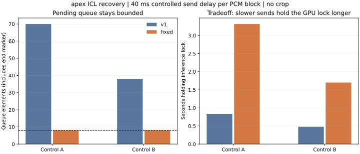

# 连续取消、断连与恢复：独立候选 v2

执行日期2026-10-21，文档收尾2026-10-22（America/Chicago）。按[冻结计划](PLAN.md)，在apex独立入口比较上轮取消候选v1与本轮v2，两臂均为默认ICL。生产bridge、插件、有效配置未替换，裁剪保持关闭；没有采用仅向量或重复惩罚1.15。

**结论：四处生命周期边界已修，连续停止和后继请求通过；有界队列限制了积压，也延长慢发送下的持锁时间。候选继续隔离，下一项是发送停滞期限与持锁预算。** 本轮不宣布M0整体验收或部署完成。

## 复现与修改

先用CPU阻塞生成器和ASGI直接调用复现四个问题，原失败日志保留在私有证据目录：

| v1问题 | v2处理 | 验证边界 |
|---|---|---|
| 慢消费者时队列无上限，CPU压力用例积到1001个元素 | 应用队列最多8个元素；生产线程有界等待，取消时撤走等待的put | 仅限制应用队列，不含模型内部、一个待入队块、正在发送的块及TCP缓冲 |
| 外部取消持锁task可能在线程仍运行时释放锁 | shield线程任务；即使重复cancel，也先设置事件并等实际线程结束再放锁 | 单次CUDA操作仍须返回，不能硬中断 |
| 生成器close异常没有传给消费者，task异常未提取 | 保存生成/清理异常，在EOF处抛出；done回调提取task异常 | 已发200响应头后表现为流中断，不能改成事后的HTTP 500 |
| ASGI2.4首PCM前断连不能及时进入body清理 | JobResponse并发监听发送与disconnect，finally停止job、回收transport任务并显式aclose迭代器 | ASGI2.3/2.4矩阵在CPU测；实际HTTP另在当前Uvicorn路径测 |

[StreamJob/JobResponse](../../../scripts/tts_cancel_lifecycle.py)仍只用于独立入口；[压力适配器](../../../scripts/cancel_recovery_server.py)承载故障注入及慢发送。请求上下文事件、原始模型块前后检查和静音前取消规则沿用v1。未修改模型采样、chunk4、全文预填、自然EOS、参考音色或音频裁剪。

完整本地CPU套件88项通过（1.382秒）；apex Python3.12上13项生命周期测试通过（0.216秒）。包括排队取消、重复取消持锁task、阻塞入队撤走、32KiB正常输出字节一致、生成/close异常、ASGI2.3/2.4断连及send OSError后生成器关闭与后继请求恢复。CPU测试不替代GPU和浏览器验证。

## 数据与计时

36项HTTP用例：12断连（首PCM前/后/排队，各臂各2次）、4慢发送取消、8故障（生成与close，各臂各2次）、8快慢发送控制、2真实socket低速读取、2仅v2持锁task取消。后继短请求包含在所属用例，不另计成独立样本。另有4组浏览器连续停止、1次活跃请求中的自有进程退出与2条重启控制。

HTTP客户端位于apex，用新连接请求并主动shutdown本请求socket；首有声PCM计时为请求开始到收到首个有声PCM。消费者关闭→worker完成在服务端同一单调时钟内计算，包含自有闲置缓存清理，**不同于上轮消费者关闭→producer退出**。浏览器计时为请求到WebAudio排定的首有声采样，不是物理声卡出声。未相减跨机器绝对时间。

本轮没有加载9B、向DSH发送新对话、使用真人麦克风或测量Silero插话检测/AEC。沿用[上轮18轮完整DSH](../2026-10-20-cancel-lifecycle/RESULTS.md)作为历史结果，不把本轮HTTP数字替换成完整说完到首声。

## 断连与后继请求

每单元2次，中位数；v1已包含上轮排队取消修复，此处不是对原生产endpoint的比较。

| 场景 | 关闭→worker完成，v1 / v2 | 后继请求→有声PCM，v1 / v2 |
|---|---:|---:|
| 首PCM前 | 113.7 / 72.1ms | 303.0 / 258.3ms |
| 首PCM后 | 79.3 / 44.5ms | 264.4 / 230.8ms |
| 排队中 | 0.857 / 0.576ms | 234.5 / 242.9ms |
| 40ms慢发送中取消 | 11.6 / 50.4ms | 237.8 / 237.1ms |

排队目标两臂均0/2进入模型。全部后继请求正常；慢发送取消的worker退出反而多约39ms，每格仅2次，不作稳定速度承诺。两次v2外部取消持锁task，从cancel到producer退出107.3/96.2ms；均在线程退出后才放锁，下一个请求随后进入。所有GPU测试的同时模型调用数上限为1。没有故意在GPU重演v1提前放锁导致并行进模型的风险，该反例只在CPU复现。

## 慢客户端的明确取舍

每条文本/每臂/每发送条件各一次。受控条件是在独立ASGI send每个1024字节PCM块前延迟40ms；每块512采样、相当于32ms音频。它稳定施加应用层背压，不能当真实互联网带宽基准。另两项真实socket慢读完成且PCM一致，不能据此推断它们造成同等应用背压。

| 控制 | 发送条件 | 队列峰值v1 / v2 | 持锁v1 / v2 |
|---|---|---:|---:|
| A | 快发 | 10 / 1 | 0.837 / 0.847秒 |
| A | 每块延迟40ms | 70 / 8 | 0.829 / 3.318秒 |
| B | 快发 | 10 / 1 | 0.488 / 0.493秒 |
| B | 每块延迟40ms | 38 / 8 | 0.478 / 1.701秒 |



峰值计入EOF标记，因此8不是8个音频块始终在排队。8次受控完整输出在两臂和快慢条件下，同文本/seed的PCM逐字节相同；快发首有声PCM A为225.8/230.4ms、B为141.4/143.8ms，没有正常首声提速证据。

**当前没有发送停滞期限。** 当消费者不再前进但又未被识别为断连时，v2生产线程会阻塞入队且继续持有infer_lock，可能无限影响后继请求。有界内存不等于有界占锁。部署前须定义发送停滞与整请求持锁预算，在触发时停止生产、等线程退出、显式失败，并验证后继请求正常及普通客户端PCM不变。暂不通过丢PCM或提前释放锁来掩盖这一点。

## 异常、播放器和独立恢复

生成中注入故障，两臂均2/2表现为读错误；close注入时v1为0/2（消费者看似成功）、v2为2/2 Interrupted chunked stream/IncompleteRead。各故障后短请求全部成功。v1只加实验诊断回调以取出和记录task异常，其消费者协议仍为冻结v1，没有悄悄修复比较臂。

[实际ReplySpeaker](../../../scripts/cancel_recovery_client.js)完成4组（各臂2组），每组先首PCM前停止，再已有播放source后停止，最后播完固定短句。同一speaker对象复用；8次停止后间隙内新增source为0，4条后继音频接收与排定均为43520采样。请求→排定首声中位v1/v2为395.3/371.7ms，各仅2次。这个程序化stop/abort测试没有测人声触发VAD的延迟，也没有代填亲耳听感。完成截图保存在工作区samples/2026-10-21-cancel-recovery/player-complete.png。

只对校验过命令行归属的自有run-1进程发送SIGTERM，活跃流按2秒优雅窗口退出；信号→进程消失2356.0ms，不能当作一次取消延迟。该请求收到14848采样并预期IncompleteRead，服务端消费者关闭→producer退出67.8ms。run-2重新启动自有入口，两条固定控制PCM哈希与重启前全同，再正常退出。没有验证生产替换/回滚，不能以独立进程恢复代替M0生产恢复验收。

浏览器预检发现本机8765转发本来不存在，普通页面的persona/media请求失败。临时建立本轮8765转发，刷新自有测试页后确认麦克风、QQ、数字人、companion均关闭，再执行正式测试。结束撤回本轮8765及18766转发、关闭自有测试页，恢复开始时的转发状态；未操作用户原盲听页。

## 证据、复算与环境

[数值摘要](data/summary.json)、[音频/环境核验](data/verification.json)、[代码与运行依赖](data/runtime.json)、[最终检查](data/validation-checks.json)可公开阅读。[executed](executed)保留16份实际执行源码/依赖/浏览器bundle，包括冻结v1；配置、凭据、原音和逐字日志不进入公开包。

私有原件在工作区samples/2026-10-21-cancel-recovery及apex ~/voice-ai/experiments/20261021-cancel-recovery，后者约9.5MB，无新模型下载。81份服务端WAV逐一核对单声道16kHz PCM16和采样数；47份客户端WAV重新计算哈希，完整输出等于服务端提供的PCM，故障/退出输出为其前缀。服务端记录“提供给发送迭代器”的采样，不保证断连时每个块都到达客户端。所有正式用例、4个CPU初始失败、开发日志与两次进程记录保留。历史核验器现与各实验自身executed快照比源码，不要求历史v1等于今天的v2。

```bash
# 仅公开数值复算，不加载模型、不访问apex
python scripts/report_cancel_recovery.py --folder docs/experiments/2026-10-21-cancel-recovery
# 持有工作区私有原件时，再核验PCM与生产环境恢复
python scripts/report_cancel_recovery.py --folder docs/experiments/2026-10-21-cancel-recovery --private ../samples/2026-10-21-cancel-recovery
```

环境最近实测2026-10-21 23:57:59 CDT：生产bridge d8b527cf…、配置68dcd0a7…、插件45194657…与开始一致；STT/TTS/turn健康，原bridge3504737和ComfyUI408436保持。Ollama开始/结束均空，本轮没有加载或卸载9B。GPU占用5508→5514MiB、结束0%/10295MiB空闲，原GPU进程集合相同；自有两个进程退出、apex8766无监听。2026-10-22文档更新不代表又刷新了GPU状态。未重启其他服务、部署、提交、推送或启动子代理。

最终检查：8个本轮相关Python文件Ruff/格式、JS语法和实际播放器bundle重建字节一致、插件源码镜像及空白检查通过；51份维护文档和215个额外根目录/私有索引/CLAUDE本地链接无失效。当前公开summary复算字节一致，上一轮78WAV与其冻结源码再核验通过，旧summary和verification保持原字节。esbuild仍提示上游tsconfig.base.client.json缺失，成功构建不等于完整上游类型检查。

下一轮先处理发送不前进的期限与持锁预算，再补候选共锁/兼容与可恢复部署验收；M2真人麦克风/AEC和硬件首声、向量音色/韵律/天然轻声仍为未验收。
